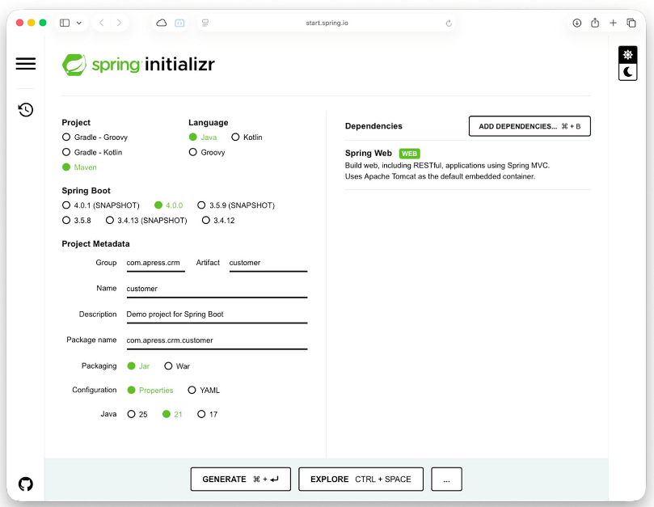
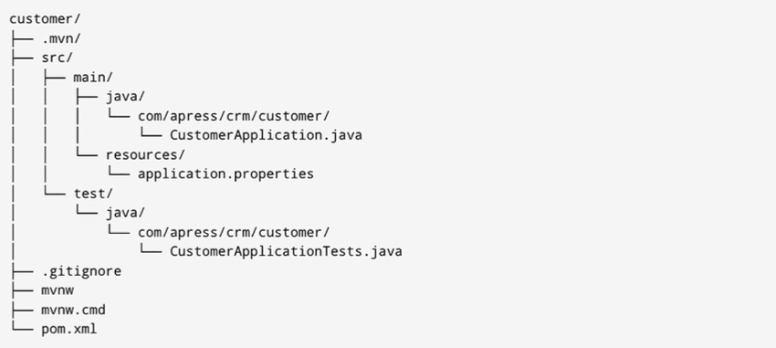
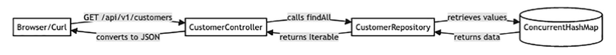
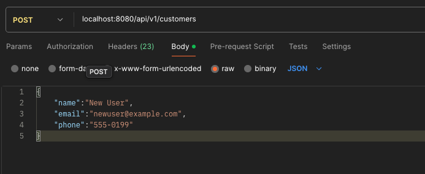

Pro Spring Boot 4'ün ilk bölümüne hoş geldiniz! Bu bölüm sizi hızlı bir şekilde Spring Boot'a dahil edecek ve bir
customer listesini bir REST API aracılığıyla sunan basit bir proje boyunca size rehberlik ederek kullanımının ne kadar
kolay olduğunu gösterecektir. Spring Boot konusunda yeniyseniz, bu bölüm framework'e hızlı bir şekilde alışmanıza
yardımcı olacaktır. Deneyimli bir yazılımcıysanız, projenin kurulumunu hızlıca gözden geçirmekten ve bir sonraki bölüme
geçmekten çekinmeyin.

## Project: Customer CRM

Customer CRM olarak adlandıracağımız ve inşa edeceğimiz proje, Web üzerinden basit bir read-only API sunacaktır. İşleri
basit tutmak için bu bölümde bir veritabanı kullanmayacağız. Bunun yerine, sabit kodlanmış bir müşteri listesiyle
başlayacağız.

Proje için gereksinimler şunlardır:

* Bir customer'in bir ID'si, bir adı, bir e-posta adresi ve bir telefon numarası olması gerekir.

* Customer bilgilerini tutmak için sabit kodlanmış bir liste kullanılır.

* Customer listesini getirmek için bir REST API sunar.

### Initial Setup

Spring Boot ile başlamak için aşağıdakilerin yüklü olması gerekir:

* Java 21 veya Daha Sonrası: Bunu OpenJDK gibi çeşitli kaynaklardan yükleyebilirsiniz.

* Bir IDE: Öneri olarak, Microsoft Visual Studio Code, JetBrains'in IntelliJ IDEA Community sürümünü veya Spring Tools'u
  kullanabilirsiniz.

* Komut Satırı HTTP Client : curl veya httpie gibi araçlar web API'lerini test etmek için yararlıdır. Bu bölümde curl
  kullanılacaktır.

### Start @ https://start.spring.io

Yeni bir Spring Boot projesi başlatmanın en kolay yolu, https://start.spring.io adresindeki Spring Initializr'ı
kullanmaktır. Proje yapısını ve dependency'leri manuel olarak yapılandırma ihtiyacını ortadan kaldırarak sizin için
temel bir proje yapısı oluşturan web tabanlı bir araçtır.

Temel özellikler ve avantajlar:

* Streamlined Project Creation: Eksiksiz ve çalıştırılmaya hazır bir proje yapısı oluşturur.

* Curated Dependencies: Projenize kolayca eklemek için ortak kütüphaneler ve framework'lerin ("starter" olarak
  adlandırılır) bir seçimini sunar.

* Customization: Build aracını (Maven veya Gradle), dili (Java, Kotlin, Groovy) ve Spring Boot sürümünü seçmenize olanak
  tanır. Customer management uygulamamız için projeyi aşağıdaki gibi yapılandırın:



* Spring Web - Bu starter, embedded bir Tomcat server ve REST API'ler oluşturmaya yönelik kütüphaneler de dahil olmak
  üzere bir web uygulaması oluşturmak için ihtiyacınız olan her şeyi içerir.

### Understanding the Project Structure

Projeyi IDE'nizde açtığınızda, aşağıdaki yapıyı görmelisiniz:



İşte anahtar dosya ve dizinlerin dökümü:

* pom.xml: Bu, Maven için Project Object Model dosyasıdır. Projenin dependency'lerini, build sürecini ve diğer
  yapılandırmalarını tanımlar.

* src/main/java: Bu klasör, uygulamanızın tüm kaynak kodunu içerir. Spring Initializr, uygulama için giriş noktası
  görevi gören ana bir uygulama sınıfı (CustomerApplication.java) oluşturur.

* src/main/resources: Bu klasör yapılandırma dosyaları ve static assets (varlıklar) içindir. application.properties
  dosyası, Spring Boot uygulamanızı yapılandırmak için kullanılır.

* src/test/java: Bu klasör tüm test kaynak kodunuzu içerir. Initializr, başlamanız için temel bir test sınıfı
  (CustomerApplicationTests.java) oluşturur.

### A look at the pom.xml

pom.xml dosyası, dependency'leri ve build yapılandırmasını yöneten bir Maven projesinin kalbidir. Spring Initializr
tarafından oluşturulan dosyanın anahtar bölümlerini inceleyelim.

```xml
<?xml version="1.0" encoding="UTF-8"?>
<project xmlns="http://maven.apache.org/POM/4.0.0" xmlns:xsi="http://www.w3.org/2001/XMLSchema-instance"
         xsi:schemaLocation="http://maven.apache.org/POM/4.0.0 https://maven.apache.org/xsd/maven-4.0.0.xsd">
    <modelVersion>4.0.0</modelVersion>
    <parent>
        <groupId>org.springframework.boot</groupId>
        <artifactId>spring-boot-starter-parent</artifactId>
        <version>4.1.1</version>
        <relativePath/> <!-- lookup parent from repository -->
    </parent>
    <groupId>com.apress.com</groupId>
    <artifactId>customer</artifactId>
    <version>0.0.1-SNAPSHOT</version>
    <name/>
    <description/>
    <url/>
    <licenses>
        <license/>
    </licenses>
    <developers>
        <developer/>
    </developers>
    <scm>
        <connection/>
        <developerConnection/>
        <tag/>
        <url/>
    </scm>
    <properties>
        <java.version>21</java.version>
    </properties>
    <dependencies>
        <dependency>
            <groupId>org.springframework.boot</groupId>
            <artifactId>spring-boot-starter-webmvc</artifactId>
        </dependency>

        <dependency>
            <groupId>org.springframework.boot</groupId>
            <artifactId>spring-boot-starter-webmvc-test</artifactId>
            <scope>test</scope>
        </dependency>
    </dependencies>

    <build>
        <plugins>
            <plugin>
                <groupId>org.springframework.boot</groupId>
                <artifactId>spring-boot-maven-plugin</artifactId>
            </plugin>
        </plugins>
    </build>

</project>
```

Bu dosyanın temel elemanları şunlardır:

* `<parent>`: spring-boot-starter-parent kullanışlı Maven default'larını sağlar. Common library'lerin dependency
  versiyonlarını yönetir ve build eklentileri (plugin'leri) için varsayılan bir yapılandırma sunar.

* `<properties>`: Burada projemizin kullanacağı Java sürümünü (Java 21) belirtiyoruz.

* `<dependencies>`: Bu bölüm, projenin dependency'lerini (bağımlılıklarını) listeler.

* spring-boot-starter-webmvc: Belirtildiği gibi, bu starter servlet tabanlı bir web uygulaması (Spring MVC) geliştirmek
  için gerekli tüm dependency'leri projeye dahil eder.

* spring-boot-starter-webmvc-test: Bu starter, JUnit 5, Spring Test ve AssertJ gibi Spring Boot web uygulamalarını test
  etmeye yönelik kütüphaneleri içerir. `<scope>test</scope>` etiketi, bu dependency'nin yalnızca test build'i sırasında
  kullanılabilir olduğunu ve nihai uygulama paketine (JAR/WAR) dahil edilmediğini belirtir.

### Creating the Customer Domain Model

Projeyi kurduktan sonraki ilk kodlama görevimiz, müşterilerimiz için bir model oluşturmaktır. Modern Java'da değişmez
(immutable) verileri modellemenin en iyi yolu bir record kullanmaktır. Record'lar, temel amacı veri taşımak olan
sınıfları hızlı ve öz bir şekilde oluşturmanın yoludur.

`com.apress.crm.customer` package'ı içinde Customer adında yeni bir Java record'u oluşturun. Bu record, customer'ın
ID'si, adı, email'i ve telefon numarası için field'lara sahip olacaktır.

```java
public record Customer(UUID id, String name, String email, String phone) {
    public Customer(String name, String email, String phone) {
        this(UUID.randomUUID(), name, email, phone);
    }
}
```

Bu declaration, bize id, name, email ve phone attribute'larına sahip bir Customer type'ı verir. Ayrıca yeni bir customer
oluştururken id field'ı için otomatik olarak bir UUID üretmek üzere bir compact constructor ekledik. Java compiler'ı;
bir constructor, equals (), hashCode () ve toString () metotlarını otomatik olarak üreterek bizi boilerplate kod
yazmaktan
kurtarır.

### Creating the Repository

Uygulama mimarimizi temiz tutmak için data access logic'i web layer'ından ayırmalıyız. Customer'larımız için generic
bir repository interface'i ve özel bir implementation tanımlayacağız.

İlk olarak, generic bir repository interface'i oluşturun:

```java
public interface Repository<T, ID> {
    T save(T entity);

    T findById(ID id);

    Iterable<T> findAll();

    void deleteById(ID id);
}
```

Ardından, CustomerRepository implementation'ını oluşturun. Bu bölüm için, in-memory bir database'i simüle etmek
amacıyla bir ConcurrentHashMap kullanacağız.

ConcurrentHashMap, Java'da multi-threaded uygulamalarda veri tutarlılığını sağlamak ve yüksek performanslı thread-safe
bir Map yapısı sunmak için kullanılır.

* Thread-Safety: Standart HashMap, birden fazla thread aynı anda okuma/yazma yaptığında veri kaybına veya sonsuz
  döngülere (ConcurrentModificationException) yol açabilir. ConcurrentHashMap bu çökme ve veri bozulmalarını
  engeller.

* Yüksek Performans (Segment / Bucket Locking): Eski Hashtable veya Collections.synchronizedMap gibi yapılar, herhangi
  bir işlem sırasında tüm map'i kilitler (full-map lock). ConcurrentHashMap ise veriyi parçalara bölerek sadece ilgili
  düğümü veya kovayı (bucket) kilitler. Böylece diğer thread'ler farklı verilere aynı anda erişebilir.

* Kilitsiz Okuma (Lock-free Reads): Okuma (get) işlemleri genellikle hiç kilit mekanizması kullanmaz (volatile bellek
  mantığıyla çalışır). Bu da okuma ağırlıklı sistemlerde muazzam bir hız avantajı sağlar.

* Atomic İşlemler: putIfAbsent, remove, replace gibi "önce kontrol et, sonra değiştir" adımlarını tek bir güvenli
  işlem (atomic operation) olarak çalıştırma imkanı sunar.

```java

@Component
public class CustomerRepository implements Repository<Customer, UUID> {
    Map<UUID, Customer> customers = new ConcurrentHashMap<>();

    @Override
    public Customer save(Customer entity) {
        if (entity.id() == null) {
            entity = new Customer(
                    entity.name(),
                    entity.email(),
                    entity.phone()
            );
        }
        customers.put(entity.id(), entity);
        return entity;
    }

    @Override
    public Customer findById(UUID id) {
        return customers.get(id);
    }

    @Override
    public Iterable<Customer> findAll() {
        return customers.values();
    }

    @Override
    public void deleteById(UUID id) {
        customers.remove(id);
    }
}
```

Buradaki @Component annotation'ı çok önemlidir. Spring'e bu sınıfı bir bean olarak yönetmesini söyler ve onu controller
gibi uygulamamızın diğer bölümlerine enjekte etmemize izin verir.

### Building the REST Controller

Artık Customer model'imize ve onu yönetmek için bir repository'ye sahip olduğumuza göre, REST controller'ı
oluşturabiliriz. Bu controller, CRUD (Create, Read, Update, Delete) operasyonlarını gerçekleştirmek için endpoint'leri
expose (dışa) açacaktır.

CustomerController adında yeni bir class oluşturun ve içeriğini aşağıdakilerle değiştirin:

```java

@RestController
@RequestMapping("/api/v1/customers")
public class CustomerController {
    private final Repository<Customer, UUID> repository;

    public CustomerController(Repository<Customer, UUID> repository) {
        this.repository = repository;
    }

    @GetMapping
    Iterable<Customer> findAll() {
        return repository.findAll();
    }

    @GetMapping("/{id}")
    Customer findById(@PathVariable UUID id) {
        return repository.findById(id);
    }

    @PostMapping
    Customer save(@RequestBody Customer customer) {
        return repository.save(customer);
    }

    @DeleteMapping("/{id}")
    void deleteById(@PathVariable UUID id) {
        repository.deleteById(id);
    }
}
```

Değişiklikleri inceleyelim;

* `@RequestMapping("/api/v1/customers")`: Bu annotation, bu controller'daki tüm endpoint'ler için temel yolu belirler.
  Sürüm tanımlı bir API yolu kullanmak best practice olarak kabul görür.

* Dependency Injection: `Repository<Customer, UUID>` alan bir constructor tanımladık. Spring Boot, daha önce
  oluşturduğumuz CustomerRepository bean'ini otomatik olarak enjekte eder. Bu, constructor injection olarak bilinir.

***HTTP Methods:***

* `@GetMapping`: GET isteklerini map eder. Tüm customer'ları listelemek için bir tane ve `/{id}` kullanarak ID'ye göre
  belirli bir customer'ı getirmek için bir tane var.

* `@PostMapping`: Bir customer create etmek veya update etmek için POST isteklerini map eder. `@RequestBody`
  annotation'ı, Spring'e gelen JSON'ı bir Customer object'ine dönüştürmesini (deserialize etmesini) söyler.

* `@DeleteMapping("/{id}")`: Bir customer'ı ID'ye göre silmek için DELETE isteklerini map eder.

* `@PathVariable`: URL'deki `{id}` placeholder'ini metot parametresine bağlar.



### Populating Initial Data

Uygulamamızı test etmeyi kolaylaştırmak için, uygulama başladığında repository'mizi bazı örnek data'lar ile önceden
doldurabiliriz. Bunu, ApplicationReadyEvent'i dinleyen bir configuration sınıfı oluşturarak yapabiliriz.

`com.apress.crm.customer` package'ı içinde CustomerConfiguration adında yeni bir class oluşturun:

```java

@Configuration
public class CustomerConfiguration {
    @Bean
    ApplicationListener<ApplicationReadyEvent> customerAppReady(Repository<Customer, UUID> customerRepository) {
        return event -> {
            customerRepository.save(new Customer("John", "john@example.com", "1-800-PHONE"));
            customerRepository.save(new Customer("Jane", "jane@example.com", "1-800-PHONE"));
            customerRepository.save(new Customer("Jack", "jack@example.com", "1-800-PHONE"));
            customerRepository.findAll().forEach(System.out::println);
        };
    }
}
```

* `@Configuration`: Sınıfı bir bean defination source olarak işaretler.

* `ApplicationListener<ApplicationReadyEvent>`: Bu bean, Spring Boot uygulaması tamamen başladıktan ve request'lere
  hizmet etmeye hazır hale geldikten sonra trigger (tetiklenen) edilen bir listener (dinleyici) oluşturur.

* Data Injection: `Repository<Customer, UUID>`'imizi inject ediyoruz ve bunu üç örnek customer kaydetmek için
  kullanıyoruz.

* Console output: Data'nın yüklendiğini doğrulayabilmemiz için kaydedilen customer'ları console'a yazdırıyoruz.

Customer demo datalarını ApplicationListener dışında bir yöntemle daha çözebiliriz.

```java

@Configuration
public class CustomerConfiguration {
    @Bean
    CommandLineRunner customerInitializer(Repository<Customer, UUID> repository) {
        return args -> {
            repository.save(new Customer("John", "john@example.com", "1-800-PHONE"));
            repository.save(new Customer("Jane", "jane@example.com", "1-800-PHONE"));
            repository.save(new Customer("Jack", "jack@example.com", "1-800-PHONE"));
            repository.findAll().forEach(System.out::println);
        };
    }
}
```

### Running and Testing the Application

Spring Boot uygulamalarını çalıştırmak kolaydır. Spring Initializr, uygulamanın giriş noktası olan bir main metodu
içeren ana uygulama sınıfını (CustomerApplication.java) oluşturur.

Uygulamayı başlatmak için bu main metodu basitçe IDE'niz üzerinden çalıştırabilirsiniz. Alternatif olarak, projeyle
birlikte gelen Maven wrapper'ını kullanabilirsiniz:

```
./mvnw spring-boot:run
```

Uygulama başladıktan sonra konsol çıktınızı kontrol edin. CustomerConfiguration içinde oluşturduğumuz üç customer'ın,
sunucunun 8080 portunda çalıştığını belirten log ile birlikte konsola yazdırıldığını görmelisiniz.

Önceden doldurulmuş data'mız olduğu için customer listesini hemen alabiliriz. Bir terminal açın ve bir GET isteği
göndermek için curl kullanın:

```
curl http://localhost:8080/api/v1/customers
```

Yanıt, üç customer'ı ("John", "Jane", "Jack") içeren bir JSON array'i olmalıdır.

Ayrıca bir POST isteği kullanarak yeni bir customer ekleyebilirsiniz:

```
curl -X POST -H "Content-Type: application/json" -d '{"name":"New User","email":"new@example.com","phone":"555-0199"}'
http://localhost:8080/api/v1/customers
```

Ve GET isteğini tekrar çalıştırarak eklendiğini doğrulayın.

Postman aracılığı ile bu şekilde post edebiliriz;



### Automated Testing with @SpringBootTest

Elle curl ile test etmek hızlı bir kontrol için yararlı olsa da, sağlam bir uygulamanın automated testlere ihtiyacı
vardır. Spring Boot 4, RestTestClient ile test etme konusunda mükemmel destek sağlar. Kapsamlı bir integration testi
oluşturmak için üretilen test sınıfı CustomerApplicationTests.java'yı değiştirelim.

```java

@SpringBootTest(webEnvironment = SpringBootTest.WebEnvironment.RANDOM_PORT)
@AutoConfigureRestTestClient
@DirtiesContext
class CustomerApplicationTests {

    @Autowired
    private RestTestClient restTestClient;

    @Test
    void shouldRetrieveAndCreateCustomers() {
        restTestClient
                // Target servise bir HTTP GET isteği başlatılacağını belirtir.
                .get()
                // Request'in gönderileceği adresi (endpoint) tanımlar.
                .uri("/api/v1/customers")
                // Hazırlanan HTTP request'ini server'a fiilen gönderir ve server'dan gelen response'u alır.
                .exchange()
                // Server'dan dönen HTTP status kodunun 200 OK olduğunu doğrular. Request başarısız olursa
                // (örneğin 404 veya 500 dönerse) test bu noktada kalır.
                .expectStatus().isOk()
                // Response'un body'sini (JSON verisini), Java'daki Customer object'lerinden oluşan bir array'e
                // (Customer[]) dönüştürür (deserialization).
                .expectBody(Customer[].class)
                // Dönüştürülen array'e erişir ve AssertJ kütüphanesinin assertThat metodunu kullanarak array'in tam
                // olarak 3 eleman içerdiğini test eder.
                .value(customers -> assertThat(customers).hasSize(3));

        Customer customer = new Customer("New User", "newuser@example.com", "555-1199");

        restTestClient
                .post()
                .uri("/api/v1/customers")
                .body(customer)
                .exchange()
                .expectStatus().isOk()
                .expectBody(Customer.class)
                .value(savedCustomer -> {
                    assert savedCustomer != null;
                    assertThat(savedCustomer.id()).isNotNull();
                    assertThat(savedCustomer.name()).isEqualTo(customer.name());
                });

      restTestClient.delete()
              .uri("/api/v1/customers/{id}", customer.id())
              .exchange()
              .expectStatus().isOk();

      restTestClient.get()
              .uri("/api/v1/customers")
              .exchange()
              .expectStatus().isOk()
              .expectBody(Customer[].class)
              .value(customers -> assertThat(customers).hasSize(3));
    }
}
```

Bu testin kilit parçalarını inceleyelim:

* `@SpringBootTest(webEnvironment = …)` : Bu annotation, tüm application context'i yükler ve web sunucusunu rastgele bir
  portta başlatarak gerçekçi bir test ortamı sağlar.

* `@AutoConfigureRestTestClient` : Bu annotation, REST servislerini test etmek için tasarlanmış güçlü ve akıcı bir
  client olan RestTestClient'ı özel olarak yapılandırır.

* `@DirtiesContext`: bir test sırasında ApplicationContext (Spring container) üzerinde yapılan değişikliklerin (örneğin
  bir bean'in state'inin, field'larının veya database'in değiştirilmesi) diğer test'leri etkilemesini önlemek için
  kullanılır. Eğer bir test application state'ini değiştirirse, sonraki test'ler bu bozulmuş veya değiştirilmiş context
  ile çalışmasın diye `@DirtiesContext` kullanılarak context'in sıfırlanması (yeniden oluşturulması) sağlanır. Böylece
  her test temiz ve yalıtılmış bir context ile çalışır.

* `RestTestClient` : Çalışan uygulamamıza karşı HTTP request'leri gerçekleştirmek için bu client'i inject ediyoruz.

* Initial Verification : Bir GET request'i gönderiyoruz ve response body'sinin 3 elemanlı (önceden yüklediğimiz data)
  bir Customer object'leri array'i içerdiğini doğruluyoruz. JSON array'ini deserialize için
  `.expectBody(Customer[].class)` kullanımına dikkat edin.

* POST Request: Yeni bir Customer object'i oluşturuyoruz ve bunu bir POST request'i ile gönderiyoruz. Response
  durumunun (status) OK olduğunu kontrol ediyoruz ve dönen customer'ın geçerli bir ID'ye ve doğru isme sahip olduğunu
  doğruluyoruz (assert).

* Final Verification : Yeni customer'ın kalıcı hale getirildiğinden (persisted) emin olmak için başka bir GET request'i
  gönderiyoruz ve toplam sayının artık 4 olduğunu doğruluyoruz.

Bu testi doğrudan IDE'niz üzerinden veya terminalinizde `./mvnw test` komutunu çalıştırarak çalıştırabilirsiniz. Bu
automated test, hem ilk data yüklemenizin hem de REST API uç noktalarınızın (endpoints) birlikte doğru şekilde
çalıştığından emin olmanızı sağlar.