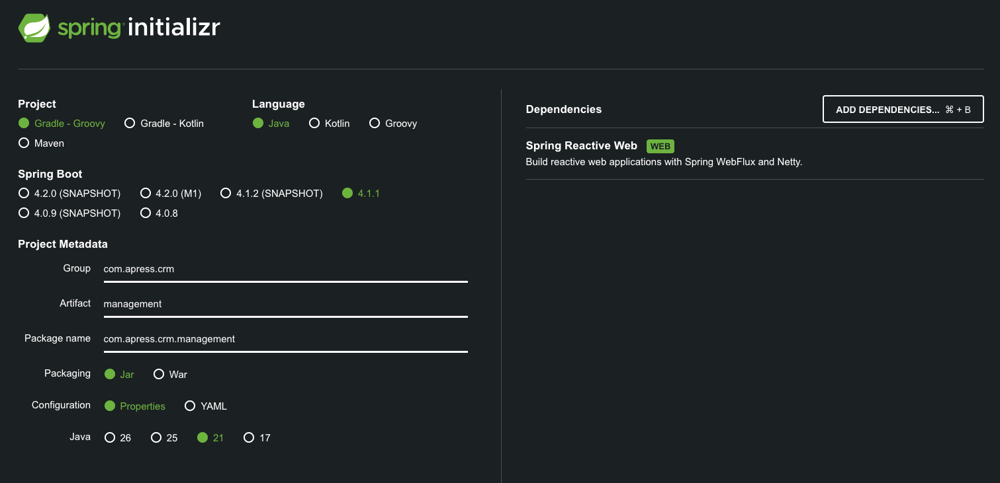

## Project: Management CRM (Reactive)

Customer CRM'e ek olarak, daha gelişmiş bir projeyi de inceleyeceğiz: Management CRM. Bu uygulama, müşteriler
(customers), şirketler (companies), adresler (addresses) ve iletişimler (communications) dâhil olmak üzere daha geniş
bir
alan kümesini (domains) ele alır. Spring Boot'un çok yönlülüğünü sergilemek için bu proje, yapılandırma aracı (build
tool) olarak Gradle kullanılarak reaktif bir web uygulaması olarak inşa edilecektir.



* `spring-boot-starter-webflux` : Standart `spring-boot-starter-webmvc` (Servlet tabanlı uygulamalar için kullanılan)
  yerine WebFlux starter'ı kullanıyoruz. Bu, Project Reactor ve Netty'ye dayalı reactive stack etkinleştirir.

* Gradle DSL: Birçok Spring projesinde yaygın olan Gradle için Groovy DSL'i kullanıyoruz.

### Defining the Reactive Domain Models

Management CRM'de yönetmemiz gereken birkaç entities bulunmaktadır. Domain models tanımlamak için Java record'larını
kullanacağız.

İlk olarak, Address sınıfı:

```java
public record Address(
        UUID addressId,
        UUID customerId,
        String street,
        String city,
        String state,
        String zip
) {
}
```

Sonra, Communication sınıfı:

```java
public record Communication(
        UUID communicationId,
        UUID customerId,
        String communicationType,
        String communicationValue
) {
}
```

Daha sonra Company sınıfı;

```java
public record Company(
        UUID companyId,
        String companyName,
        String industry,
        String website
) {
}
```

Customer sınıfı;

```java
public record Customer(
        UUID customerId,
        String firstName,
        String lastName,
        String jobTitle,
        String email,
        String phone,
        UUID companyId
) {
}
```

Ve son olarak, bilgileri bir araya getirmek (aggregate) için CustomerDetailsDTO:

```java
public record CustomerDetailsDTO(
        Customer customer,
        Company company,
        List<Address> addresses,
        List<Communication> communications
) {
}
```

### Creating Reactive Repositories

Customer CRM'de olduğu gibi, verilerimizi işlemek için repository'lere ihtiyacımız var.
`com.apress.crm.management.repository` package'i altında generic Repository interface'ini tanımlayarak başlayacağız:

```java
public interface Repository<T, ID> {
    T save(T entity);

    T findById(ID id);

    Iterable<T> findAll();

    void deleteById(ID id);
}
```

Şimdi, in-memory storage için ConcurrentHashMap kullanarak ilgili repository'leri implement edelim.

AddressRepository.java:

```java

@Component
public class AddressRepository implements Repository<Address, UUID> {
    private final Map<UUID, Address> addresses = new ConcurrentHashMap<>();

    @Override
    public Address save(Address entity) {
        if (entity.addressId() == null) {
            UUID addressId = UUID.randomUUID();
            entity = new Address(
                    addressId,
                    entity.customerId(),
                    entity.street(),
                    entity.city(),
                    entity.state(),
                    entity.zip()
            );
        }
        this.addresses.put(entity.addressId(), entity);
        return entity;
    }

    @Override
    public Address findById(UUID id) {
        return this.addresses.get(id);
    }

    @Override
    public Iterable<Address> findAll() {
        return this.addresses.values();
    }

    @Override
    public void deleteById(UUID id) {
        this.addresses.remove(id);
    }

    public Iterable<Address> findAllByCustomerId(UUID customerId) {
        return this.addresses
                .values()
                .stream()
                .filter(address -> address.customerId().equals(customerId))
                .collect(Collectors.toList());
    }
}
```

CommunicationRepository.java;

```java

@Component
public class CommunicationRepository implements Repository<Communication, UUID> {
    private final Map<UUID, Communication> communications = new ConcurrentHashMap<>();

    @Override
    public Communication save(Communication entity) {
        if (entity.communicationId() == null) {
            UUID id = UUID.randomUUID();
            entity = new Communication(
                    id,
                    entity.customerId(),
                    entity.communicationType(),
                    entity.communicationValue()
            );
        }
        communications.put(entity.communicationId(), entity);
        return entity;
    }

    @Override
    public Communication findById(UUID id) {
        return communications.get(id);
    }

    @Override
    public Iterable<Communication> findAll() {
        return communications.values();
    }

    @Override
    public void deleteById(UUID id) {
        communications.remove(id);
    }

    public Iterable<Communication> findAllByCustomerId(UUID customerId) {
        return this.communications
                .values()
                .stream()
                .filter(communication -> communication.customerId().equals(customerId))
                .collect(Collectors.toList());
    }
}
```

CompanyRepository.java

```java

@Component
public class CompanyRepository implements Repository<Company, UUID> {
    private final Map<UUID, Company> companies = new ConcurrentHashMap<>();

    @Override
    public Company save(Company entity) {
        if (entity.companyId() == null) {
            UUID id = UUID.randomUUID();
            entity = new Company(
                    id,
                    entity.companyName(),
                    entity.industry(),
                    entity.website()
            );
        }
        this.companies.put(entity.companyId(), entity);
        return entity;
    }

    @Override
    public Company findById(UUID id) {
        return companies.get(id);
    }

    @Override
    public Iterable<Company> findAll() {
        return companies.values();
    }

    @Override
    public void deleteById(UUID id) {
        companies.remove(id);
    }
}
```

CustomerRepository.java

```java

@Component
public class CustomerRepository implements Repository<Customer, UUID> {
    private final Map<UUID, Customer> customers = new ConcurrentHashMap<>();

    @Override
    public Customer save(Customer entity) {
        if (entity.customerId() == null) {
            UUID id = UUID.randomUUID();
            entity = new Customer(
                    id,
                    entity.firstName(),
                    entity.lastName(),
                    entity.jobTitle(),
                    entity.email(),
                    entity.phone(),
                    entity.companyId()
            );
        }
        this.customers.put(entity.customerId(), entity);
        return entity;
    }

    @Override
    public Customer findById(UUID id) {
        return customers.get(id);
    }

    @Override
    public Iterable<Customer> findAll() {
        return customers.values();
    }

    @Override
    public void deleteById(UUID id) {
        customers.remove(id);
    }

    public Iterable<Customer> findAllByCompanyId(UUID companyId) {
        return customers
                .values()
                .stream()
                .filter(customer -> customer.companyId().equals(companyId))
                .collect(Collectors.toList());
    }
}
```

### Creating the Service Layer

Daha karmaşık iş mantıklarını (business logic) yönetmek için bir servis katmanı (service layer) ekliyoruz. Servis
katmanı, tek bir business request'ini karşılamak için birden fazla repository ile iletişim kurarak bir orkestratör
görevi görür.

```java

@Service
public class ManagementService {
    private final CustomerRepository customerRepository;
    private final AddressRepository addressRepository;
    private final CommunicationRepository communicationRepository;
    private final CompanyRepository companyRepository;

    public ManagementService(
            CustomerRepository customerRepository,
            AddressRepository addressRepository,
            CommunicationRepository communicationRepository,
            CompanyRepository companyRepository) {
        this.customerRepository = customerRepository;
        this.addressRepository = addressRepository;
        this.communicationRepository = communicationRepository;
        this.companyRepository = companyRepository;
    }

    public CustomerDetailsDTO createCustomerWithDetails(
            Customer customer,
            Address address,
            Communication communication,
            Company company
    ) {
        Company savedCompany = this.companyRepository.save(company);

        Customer customerToSave = new Customer(
                null,
                customer.firstName(),
                customer.lastName(),
                customer.jobTitle(),
                customer.email(),
                customer.phone(),
                savedCompany.companyId()
        );
        Customer savedCustomer = this.customerRepository.save(customerToSave);

        Address addressToSave = new Address(
                null,
                savedCustomer.customerId(),
                address.street(),
                address.city(),
                address.state(),
                address.zip()
        );
        Address savedAddress = this.addressRepository.save(addressToSave);

        Communication communicationToSave = new Communication(
                null,
                savedCustomer.customerId(),
                communication.communicationType(),
                communication.communicationValue()
        );
        Communication savedCommunication = this.communicationRepository.save(communicationToSave);

        return new CustomerDetailsDTO(
                savedCustomer,
                savedCompany,
                List.of(savedAddress),
                List.of(savedCommunication)
        );
    }

    public CustomerDetailsDTO getCustomerDetails(UUID customerId) {
        Customer customer = this.customerRepository.findById(customerId);
        if (customer == null) {
            return null;
        }

        Company company = this.companyRepository.findById(customer.companyId());

        List<Address> addresses = StreamSupport
                .stream(this.addressRepository
                        .findAllByCustomerId(customerId)
                        .spliterator(), false)
                .toList();

        List<Communication> communications = StreamSupport.stream(this.communicationRepository
                .findAllByCustomerId(customerId)
                .spliterator(), false
        ).toList();

        return new CustomerDetailsDTO(customer, company, addresses, communications);
    }
}
```

### Implementing Reactive REST Handlers

Management CRM için, handlers ve routers kullanarak fonksiyonel stili (functional style) sergileyeceğiz.

```java

@Component
public class ManagementHandlers {
    private final ManagementService managementService;

    public ManagementHandlers(ManagementService managementService) {
        this.managementService = managementService;
    }

    public Mono<ServerResponse> getCustomerDetails(ServerRequest request) {
        String id = request.pathVariable("id");
        CustomerDetailsDTO details = managementService.getCustomerDetails(UUID.fromString(id));
        if (details != null) {
            return ServerResponse.ok().bodyValue(details);
        } else {
            return ServerResponse.notFound().build();
        }
    }
}
```

Yukarıda ki kod bloğu Spring WebFlux kullanarak yazılmış reaktif (asenkron ve bloklanmayan) bir web servis ucudur
(endpoint). Verilen bir customer ID'sine (id) göre customer detaylarını getirir.

Mono, Project Reactor (Spring WebFlux'ın temeli) kütüphanesinden gelen reaktif bir tiptir.

* `Mono<T>`: Gelecekte en fazla 1 tane (0 veya 1) sonuç üretecek olan asenkron bir nesneyi (akışı) temsil eder.

* Klasik Java'daki `CompletableFuture<T>` veya JavaScript'teki Promise yapısına benzer. Verinin henüz hazır olmadığını,
  hazır olduğunda haber verileceğini söyler.

* İlişkili Diğer Tip (Flux): Eğer 0 ile N arasında (birden fazla) eleman dönecek olsaydı Mono yerine `Flux<T>`
  kullanılırdı.

Bu metodda `Mono<ServerResponse>` kullanılmasının sebebi; HTTP response'unun (ServerResponse) asenkron bir reaktif akış
olarak client'a (browser/mobil vb.) döndürülecek olmasıdır.

0 öğe: Örneğin yukarıdaki kodda customer bulunamadığında (null döndüğünde) ServerResponse.notFound ().build () döner.
Bu, "boş bir Mono" demektir (HTTP 404 Not Found). 1 öğe: Müşteri bulunduğunda ise içinde bir adet CustomerDetailsDTO
nesnesi barındıran bir Mono döner (HTTP 200 OK).

Klasik (Imperative) Koddan Farkı Nedir? Normalde geleneksel (Spring MVC / Servlet tabanlı) bir yapıda metot doğrudan
CustomerDetailsDTO nesnesinin kendisini dönerdi:

```
// Geleneksel Spring MVC
public CustomerDetailsDTO getCustomerDetails(...) {
    return managementService.getCustomerDetails(...);
}
```

Burada server, veritabanından veri gelene kadar bekler (bloklar) ve o iş parçacığı (thread) başka bir istek için
kullanılamaz.

Mono kullandığında metot hemen bir "paket" (Mono nesnesi) döner. Asıl verinin veritabanından gelmesi beklenirken sunucu
thread'i meşgul edilmez, boşa çıkar ve başka kullanıcılara hizmet etmeye devam eder. Veri hazır olduğunda ise Mono
tetiklenir ve HTTP yanıtı istemciye iletilir.

ServerResponse Nedir? Spring WebFlux'ın fonksiyonel web altyapısında (Router/Handler modelinde) HTTP response'unu
represent eden nesnedir. Client'a döneceğin HTTP status kodunu (200 OK, 404 Not Found vb.), başlıkları (headers) ve
gövdeyi (body) bu nesne üzerinden belirlersin. `Mono<ServerResponse>` Nedir? Daha önce konuştuğumuz gibi, bu yanıtın
asenkron ve reaktif bir şekilde üretileceğini söyler. İçinde 1 adet HTTP yanıtı (ServerResponse) barındırabilecek veya
(hata durumunda) boş dönebilecek asenkron bir reaktif pakettir. "Spring, bu HTTP isteğine verilecek yanıt hemen hazır
değil ya da asenkron işleniyor. Sana bir ServerResponse nesnesini doğrudan vermiyorum; ama hazır olduğunda içinde
ServerResponse taşıyacak olan bu Mono paketini veriyorum. Sen bunu dinle, veri hazır olunca istemciye bas."

### Configuring the Reactive Router

Functional Web Framework, gelen request'leri handler function'lara eşlemek için bir RouterFunction kullanırız.

```java

@Configuration
public class ManagementConfiguration {
    @Bean
    ApplicationListener<ApplicationReadyEvent> managementReady(ManagementService managementService) {
        return event -> {
            // Customer 1
            Company company1 = new Company(
                    null,
                    "Apress",
                    "Publishing",
                    "apress.com"
            );
            Customer customer1 = new Customer(
                    null,
                    "Felipe",
                    "Gomez",
                    "Author",
                    "felipe.gomez@apress.com",
                    "123-4567890",
                    null
            );
            Address address1 = new Address(
                    null,
                    null,
                    "123 Main St.",
                    "New York",
                    "NY",
                    "10001"
            );
            Communication communication1 = new Communication(
                    null,
                    null,
                    "email",
                    "felipe.gomez@apress.com"
            );

            System.out.println("Creating customer 1 : " + managementService.createCustomerWithDetails(
                    customer1, address1, communication1, company1
            ));

            // Customer 2
            Company company2 = new Company(
                    null,
                    "Spring",
                    "Software",
                    "spring.io"
            );
            Customer customer2 = new Customer(
                    null,
                    "Josh",
                    "Long",
                    "Developer Advocate",
                    "josh.long@spring.io",
                    "098-765-4321",
                    null
            );
            Address address2 = new Address(
                    null,
                    null,
                    "456 Oak Ave",
                    "San Francisco",
                    "CA",
                    "94102"
            );
            Communication communication2 = new Communication(
                    null,
                    null,
                    "twitter",
                    "@starbuxman");

            System.out.println("Creating customer 2: " + managementService.createCustomerWithDetails(
                    customer2, address2, communication2, company2
            ));

            // Customer 3
            Company company3 = new Company(
                    null,
                    "Google",
                    "Technology",
                    "google.com"
            );
            Customer customer3 = new Customer(
                    null,
                    "Sundar",
                    "Pichai",
                    "CEO",
                    "sundar.pichai@google.com",
                    "111-222-3333",
                    null
            );
            Address address3 = new Address(
                    null,
                    null,
                    "789 Pine Ln",
                    "Mountain View",
                    "CA",
                    "94043"
            );
            Communication communication3 = new Communication(
                    null,
                    null,
                    "email",
                    "sundar.pichai@google.com"
            );
            System.out.println("Creating customer 3: " + managementService.createCustomerWithDetails(
                    customer3, address3, communication3, company3
            ));
        };
    }

    @Bean
    RouterFunction<ServerResponse> managementRoutes(ManagementHandlers handlers) {
        return route(GET("/api/v1/management/customers/{id}"), handlers::getCustomerDetails);
    }
}
```

Bu Spring Boot konfigürasyon sınıfı (ManagementConfiguration), uygulamanın başlangıcında örnek veri (seed data)
oluşturmak ve bir HTTP REST endpoint tanımlamak için kullanılır.

managementRoutes methodu; Spring WebFlux (Functional Endpoints) yapısını kullanarak reactive bir HTTP route tanımlar.
`GET /api/v1/management/customers/{id}` request'i geldiğinde bu request'i karşılar ve yanıt üretmek üzere `handlers::
getCustomerDetails` metoduna yönlendirir.

`RouterFunction`, Spring WebFlux ile gelen Fonksiyonel Web Programlama (Functional Endpoints) modelinde, gelen HTTP
request'lerini yönlendirmek (route etmek) için kullanılan ana arabirimdir. Klasik Spring MVC/WebFlux'taki
@RestController ve @GetMapping gibi annotation tabanlı yapıların fonksiyonel bir alternatifidir. Annotation tabanlı
yapıda request'lerin nereye gideceğini @RequestMapping gibi anotasyonlar belirlerken, RouterFunction kullanıldığında
request'leri kod seviyesinde yönlendirirsiniz:

* Predicates: Hangi HTTP metodu (GET, POST), hangi URL route `(/api/v1/users/{id})` veya hangi headers eşleşecek?

* Handler Function: Eşleşen istek geldikten sonra hangi fonksiyon çalışacak ve yanıt üretecek?

### Testing the Reactive Application

Reactive bir uygulamayı test etmek, asynchronous streams yönetebilen araçlar gerektirir.

```java

@SpringBootTest(webEnvironment = SpringBootTest.WebEnvironment.RANDOM_PORT)
@AutoConfigureWebTestClient
class ManagementApplicationTests {

    @Autowired
    WebTestClient webTestClient;

    @Autowired
    CustomerRepository customerRepository;

    @Test
    void shouldRetrieveCustomerDetails() {
        Iterable<Customer> customers = customerRepository.findAll();
        assertThat(customers).isNotEmpty();

        Customer customer = customers.iterator().next();
        webTestClient.get()
                .uri("/api/v1/management/customers/" + customer.customerId())
                .exchange()
                .expectStatus().isOk()
                .expectBody(CustomerDetailsDTO.class)
                .value(dto -> {
                    assertThat(dto).isNotNull();
                    assertThat(dto.customer()).isNotNull();
                    assertThat(dto.customer().customerId()).isEqualTo(customer.customerId());
                    assertThat(dto.customer().firstName()).isEqualTo(customer.firstName());
                    assertThat(dto.customer().lastName()).isEqualTo(customer.lastName());
                    assertThat(dto.company()).isNotNull();
                    assertThat(dto.addresses()).isNotEmpty();
                    assertThat(dto.communications()).isNotEmpty();
                });
    }

    @Test
    void shouldReturnNotFoundForInvalidId() {
        webTestClient.get()
                .uri("/api/v1/management/customers/" + UUID.randomUUID())
                .exchange()
                .expectStatus()
                .isNotFound();
    }
}
```

### Why Spring Boot?

Henüz yeni başlıyor olsak da, Spring Framework'ün ne olduğunu ve Spring Boot'un neden bu kadar önemli olduğunu anlamak
önemlidir. Spring Framework aşağıdaki yol gösterici ilkelere sahiptir:

* Provide Choice at Every Level: Spring, tasarım kararlarını mümkün olduğunca geç bir aşamaya ertelemenize izin verir.

* Accommodate Diverse Perspectives: Spring esnekliği benimser ve işlerin nasıl yapılması gerektiği konusunda fikir
  dayatmaz.

* Maintain Strong Backward Compatibility: Spring’in gelişimi, sürümler arasında az sayıda kırıcı değişikliği zorunlu
  kılacak şekilde dikkatle yönetilmiştir.

* Care About API Design: Spring ekibi, sezgisel olan ve birçok sürüm ile uzun yıllar boyunca geçerliliğini koruyan
  API'ler yapmaya çok fazla düşünce ve zaman ayırır.

* Set High Standards for Code Quality: Spring Framework, anlamlı, güncel ve doğru Javadoc'a güçlü bir vurgu yapar.

Spring Boot kullanmanın en büyük avantajı, Spring Framework'e dayanması ve uygulanan tüm en iyi uygulamalarla onu
enterprise-ready hale getirmesidir. Ve Spring Boot fikir dayatan bir yapıda olduğu için her şeyi sizin için konfigüre
edecektir, bu da (bazen) sıfır konfigürasyon ile sonuçlanır.