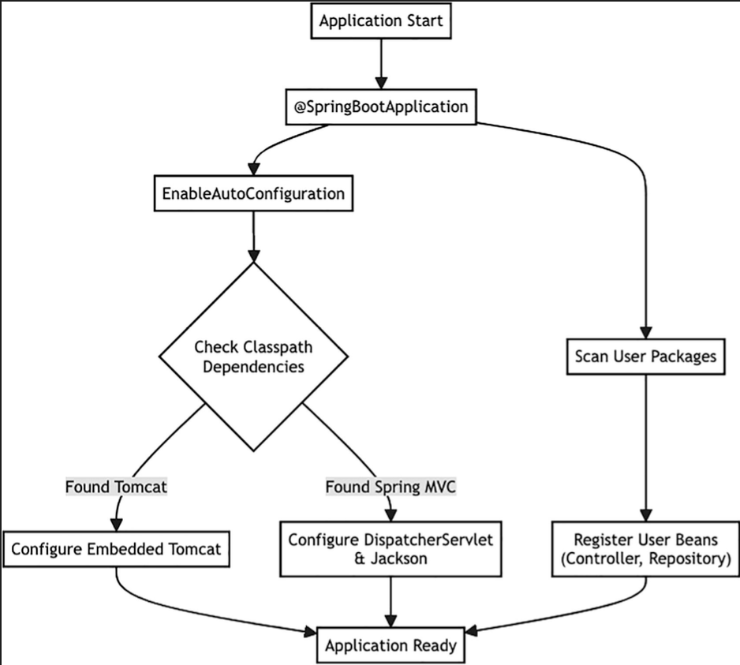
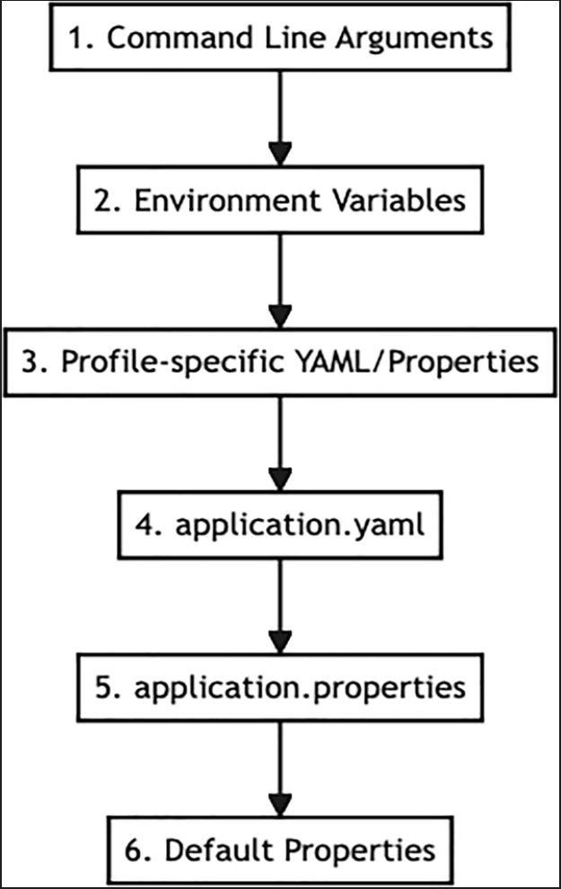
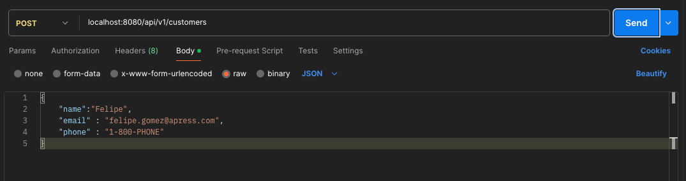
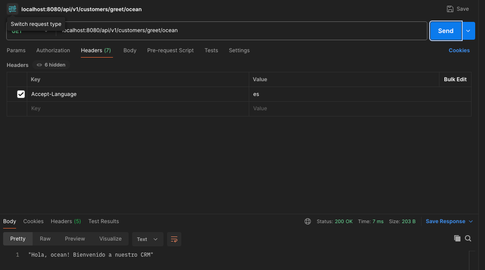
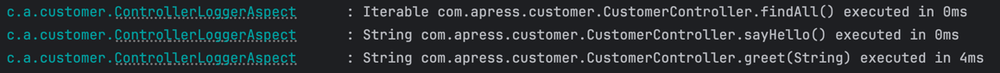

# Spring Boot Internals and Features

Önceki bölümde, in-memory bir repository ile desteklenen basit bir REST API olan “Customer CRM” uygulamasını inşa ettik.
Spring Boot ile bir web uygulamasını ne kadar hızlı çalıştırabileceğinizi gördünüz. Şimdi, kaputun altına bakma zamanı.

Bu bölüm, oto-konfigürasyonun “sihrinin” ötesine geçer. Spring Boot'un production-ready uygulamalar inşa etmenize
yardımcı olmak için sunduğu temel özellikleri inceleyeceğiz. Customer CRM projemizi, başlatma sürecini nasıl kontrol
edeceğimizi, konfigürasyonu harici olarak nasıl yöneteceğimizi, loglamayı, internationalization'ı, görev zamanlamayı ve
hatta aspect-oriented programming (AOP) tekniğinden nasıl yararlanacağımızı göstermek için değiştireceğiz.

## How Spring Boot Works (The Magic)

Özelleştirmeye başlamadan önce, sahne arkasında ne olduğunu anlamak çok önemlidir. CustomerApplication'ınızı
çalıştırdığınızda, Spring Boot REST API'nizi ayağa kaldırmak ve çalıştırmak için çok ağır bir iş yükünü üstlenir. Bu
“sihir”, öncelikle auto-configuration tarafından yönlendirilir.

### The @SpringBootApplication Annotation

Her şey main sınıfınızdaki @SpringBootApplication annotation'ı ile başlar. Bu, diğer üç önemli annotation'ı birleştiren
bir meta-annotation'dır:

1. `@SpringBootConfiguration`: Class'ı, bean tanımları için bir configuration source olarak işaretler (esasen
   `@Configuration` için bir alias'dır).

2. `@ComponentScan`: Spring'e component'ler, configuration'lar ve service'ler için mevcut package'i
   `(com.apress.crm.customer)` ve onun sub package'larını taramasını söyler. CustomerController ve
   CustomerRepository'mizin otomatik olarak bulunmasının nedeni budur.

3. `@EnableAutoConfiguration`: Gerçek sihrin gerçekleştiği yer burasıdır. Eklediğiniz jar dependency'lerine dayanarak
   uygulamanızı nasıl konfigüre etmek istediğinizi Spring Boot'un “tahmin etmesini” söyler.

### Auto-Configuration Internals

Spring Boot 4'te auto-configuration her zamankinden daha modülerdir. Tek bir devasa konfigürasyon dosyasına güvenmek
yerine, kütüphaneler ve starter'lar kendi auto-configuration'larını declare eder.

Uygulama başladığında, @EnableAutoConfiguration classpath'inizdeki tüm jar dosyalarının içinde
`META-INF/spring/org.springframework.boot.autoconfigure.AutoConfiguration.imports` adındaki dosyalar için bir arama
tetikler. Bu dosyalar uygulanabilecek konfigürasyon sınıflarının listelerini içerir.

Aday her bir configuration sınıfı için Spring Boot, o sınıfı yükleyip yüklemeyeceğine karar vermek amacıyla bir dizi
koşulu (@Conditional annotation'larını kullanarak) kontrol eder.

### Tracing the Customer CRM Startup

Customer CRM'imizi başlattığımızda ne olduğunu izleyelim:

1. Dependency Detection: Spring Boot, classpath üzerinde spring-boot-starter-webmvc'yi görür

2. Web Server Configuration: Bir configuration adayı bulur (örneğin ServletWebServerFactoryAutoConfiguration). Şunları
   kontrol eder: “Classpath üzerinde bir Tomcat sınıfı var mı?” (Evet, starter tarafından getirildi). “Zaten kullanıcı
   tarafından tanımlanmış bir server bean'i var mı?” (Hayır). Sonuç: 8080 portunu dinleyen gömülü bir Tomcat server
   konfigüre eder.

3. Spring MVC Configuration: WebMvcAutoConfiguration'ı bulur. Şunu kontrol eder: “Bu bir web uygulaması mı?” (Evet).
   Sonuç: REST API'miz için DispatcherServlet'ı, default error handling'i ve JSON message converters (Jackson)
   konfigüre eder.

4. Application Logic: Son olarak, @ComponentScan sayesinde CustomerController ve CustomerRepository bean'lerinizi bulur,
   kaydeder ve birbirine bağlar (wire eder).



Bu “convention over configuration” (yapılandırmaya karşı kabul) yaklaşımı, Spring Boot'un sizin için makul varsayılanlar
oluşturduğu (“8080 portunda Tomcat kullan” gibi), ancak kendi konfigürasyonunuzu tanımlamanız durumunda (kendi
ServerFactory bean'inizi tanımlamanız gibi) derhal geri çekildiği anlamına gelir.

## The SpringApplication Class

SpringApplication sınıfı, Spring Boot uygulamanızın giriş noktasıdır. Bölüm 1'de static run metodunu kullanmıştık:

```java
public static void main(String[] args) {
    SpringApplication.run(CustomerApplication.class, args);
}
```

Bu durum çoğu senaryo için yeterli olsa da, SpringApplication sınıfı başlatma süreci için kapsamlı özelleştirme
seçenekleri sunar. Uygulama tipini kontrol edebilir, listener'lar ekleyebilir, banner'ı özelleştirebilir ve daha
fazlasını yapabilirsiniz.

### Customizing Startup with SpringApplicationBuilder

Uygulama başlatmayı özelleştirmek için bir SpringApplication instance'ı oluşturabilir veya akıcı (fluent)
SpringApplicationBuilder'ı kullanabiliriz.

Banner'ı programatik olarak devre dışı bırakmak ve generic bir application olarak çalışmasını sağlamak için (yine de web
ortamını otomatik olarak algılayacaktır) CustomerApplication sınıfımızı değiştirelim.

```java

@SpringBootApplication
public class CustomerApplication {
    public static void main(String[] args) {
        new SpringApplicationBuilder(CustomerApplication.class)
                .bannerMode(Banner.Mode.OFF)
                .logStartupInfo(true)
                .run(args);
    }
}
```

Başlangıçta Spring Boot banner'ının yazdırılmasını devre dışı bırakıyoruz.

### Customizing the Banner

Eğer bir banner kullanmak isterseniz, bunu uygulamanıza özel hale getirebilirsiniz. Varsayılan olarak Spring Boot,
`src/main/resources` dizini altında bir banner.txt dosyası arar.

`src/main/resources` dizini altında aşağıdaki içeriğe sahip banner.txt adında bir dosya oluşturun:

`https://patorjk.com/software/taag` web sayfasında istediğiniz banner'i create edebilirsiniz.

Şimdi, eğer uygulama sınıfınızdan .bannerMode (Banner.Mode.OFF) satırını kaldırırsanız, uygulama başladığında bu ASCII
çizimini görürsünüz. Hatta bu dosya içerisinde, mevcut Boot sürümünü görüntülemek için `${spring-boot.version}` gibi
değişkenler de kullanabilirsiniz.

### Externalized Configuration

Spring Boot’un en güçlü özelliklerinden biri, harici yapılandırma (externalized configuration) desteğidir. Bu sayede
aynı uygulama kodunu hiçbir değişiklik yapmadan farklı ortamlarda (geliştirme, test, üretim) çalıştırabilirsiniz.
Yapılandırmanızı yönetmek için properties dosyalarını, YAML dosyalarını, ortam değişkenlerini (environment variables) ve
komut satırı argümanlarını kullanabilirsiniz.

Spring Boot, özellikleri çözümlemek için oldukça belirli bir öncelik sırası kullanır; ancak çoğu zaman
src/main/resources altında yer alan application.properties veya application.yaml dosyalarıyla çalışırsınız.

***Figure 2-3 Spring Boot Configuration Precedence***



### Type-Safe Configuration Properties

Bireysel özellikleri enjekte etmek için @Value annotation'ını kullanabilseniz de Spring Boot, tür güvenli (type-safe)
konfigürasyon özelliklerinin kullanılmasını teşvik eder. Bu yaklaşım, yapılandırma dosyanızdaki belirli bir ön eke
(prefix) karşılık gelen bir sınıf (veya bir record) oluşturmayı içerir.

Customer CRM uygulamamızın ayarlarını tutmak için bir CrmProperties record'u oluşturalım.

```java

@ConfigurationProperties(prefix = "crm")
public record CrmProperties(String welcomeMessage, int maxResults) {
}
```

* `@ConfigurationProperties`: external özellikleri bir Java object’ine bağlar. Esnek bağlamayı destekler; yani
  `crm.welcome-message`, `crm.welcome_message` ve `crm.WELCOME_MESSAGE` ifadelerinin hepsi aynı field’a karşılık gelir.

* Prefixing: Prefix attribute'u, properties'leri logical gruplara ayırarak uygulamanız büyüdükçe configuration
  yönetiminizi kolaylaştırır.

Bunu kullanmak için `application.properties` dosyanıza aşağıdakileri ekleyin:

```properties
crm.welcome-message=Welcome to the Pro Spring Boot 4 CRM!
crm.max-results=50
```

Son olarak, Spring'e bu özellikleri aramasını söylemeniz gerekir. Bunu, main application sınıfınıza
`@ConfigurationPropertiesScan` annotation'ını ekleyerek yapabilirsiniz.

```java

@SpringBootApplication
@ConfigurationPropertiesScan
public class CustomerApplication {
    public static void main(String[] args) {
        new SpringApplicationBuilder(CustomerApplication.class)
                .bannerMode(Banner.Mode.OFF)
                .logStartupInfo(true)
                .run(args);
    }
}
```

* `@ConfigurationPropertiesScan`: `@ConfigurationProperties` ile annotation yapılmış sınıfları otomatik olarak keşfeder
  ve bunları bean olarak kaydeder.

Şimdi bir controller oluşturup application.properties içerisinde ki değerleri test edebilmek için dosyalarımızı
oluşturalım.

Customer.java;

```java
public record Customer(
        UUID id,
        String name,
        String email,
        String phone
) {
    public Customer(String name, String email, String phone) {
        this(UUID.randomUUID(), name, email, phone);
    }
}
```

Repository.java;

```java
public interface Repository<T, ID> {
    T save(T entity);

    T findById(ID id);

    Iterable<T> findAll();

    void delete(ID id);
}
```

CustomerRepository.java;

```java

@Component
public class CustomerRepository implements Repository<Customer, UUID> {
    private final ConcurrentHashMap<UUID, Customer> customers = new ConcurrentHashMap<>();

    @Override
    public Customer save(Customer entity) {
        if (entity.id() == null) {
            entity = new Customer(
                    entity.name(),
                    entity.email(),
                    entity.phone()
            );
        }
        customers.put(entity.id(), entity);
        return entity;
    }

    @Override
    public Customer findById(UUID id) {
        return customers.get(id);
    }

    @Override
    public Iterable<Customer> findAll() {
        return customers.values();
    }

    @Override
    public void delete(UUID id) {
        customers.remove(id);
    }
}
```

CustomerConfiguration.java;

```java

@Configuration
public class CustomerConfiguration {
    @Bean
    ApplicationListener<ApplicationReadyEvent> customerAppReady(Repository<Customer, UUID> repository) {
        return event -> {
            repository.save(new Customer("John", "john@example.com", "1-800-PHONE"));
            repository.save(new Customer("Jane", "jane@example.com", "1-800-PHONE"));
            repository.save(new Customer("Jack", "jack@example.com", "1-800-PHONE"));
            repository.findAll().forEach(System.out::println);
        };
    }
}
```

Artık tıpkı diğer bean'lerde olduğu gibi, uygulamanızın herhangi bir yerinde CrmProperties sınıfını enjekte
edebilirsiniz (inject edebilirsiniz).

```java

@RestController
@RequestMapping("/api/v1/customers")
public class CustomerController {
    private final CrmProperties crmProperties;
    private final Repository<Customer, UUID> repository;

    public CustomerController(CrmProperties crmProperties, Repository<Customer, UUID> repository) {
        this.crmProperties = crmProperties;
        this.repository = repository;
    }

    @GetMapping("/welcome")
    public String sayHello() {
        return this.crmProperties.welcomeMessage();
    }

    @GetMapping
    public Iterable<Customer> findAll() {
        return this.repository.findAll();
    }

    @GetMapping("/{id}")
    public Customer findById(@PathVariable UUID id) {
        return this.repository.findById(id);
    }

    @PostMapping
    public Customer save(@RequestBody Customer customer) {
        return this.repository.save(customer);
    }

    @DeleteMapping("/{id}")
    public void deleteById(@PathVariable UUID id) {
        this.repository.delete(id);
    }
}
```

## Profiles

Spring Profiles, application configuration parçalarını ayırmanın ve bunları yalnızca belirli ortamlarda kullanılabilir
hale getirmenin bir yolunu sunar. Development, testing ve production için ayrı bean definitions veya property
dosyalarına sahip olabilirsiniz.

### Profile-Specific Properties

Spring Boot, varsayılan olarak properties’leri application.properties (veya YAML) dosyasından yükler. Eğer bir profile
active durumdaysa, varsayılanları override ederek properties’leri `application-{profile}.properties` dosyasından da
yükler.

Diyelim ki “development” ortamımız için farklı bir karşılama mesajı istiyoruz. `src/main/resources` altında
`application-dev.properties` adında bir dosya oluşturun:

```properties
crm.welcome-message=Dev Mode: Fast and furious CRM!
```

Bu profile'ı activate etmek için spring.profiles.active property'sini kullanabilirsiniz. JAR run edilirken veya command
line kullanılırken:

```shell
./mvnw spring-boot:run -Dspring-boot.run.profiles=dev
```

Veya şimdilik varsayılan yapmak için bunu application.properties içinde set edin:

```properties
spring.profiles.active=dev
```

Uygulamayı restart edip `/api/v1/customers/welcome` endpoint'ine request attığınızda development mesajını göreceksiniz.

### Profile-Specific Beans

@Profile annotation'ını kullanarak bean oluşturmayı belirli profile'lar ile de kısıtlayabilirsiniz. Örneğin, dummy
verilerimizi belki sadece production'da olmadığımız zaman yüklemek isteriz.

CustomerConfiguration class'ını modify edin;

```java

@Configuration
@Profile("!prod")
public class CustomerConfiguration {
    @Bean
    ApplicationListener<ApplicationReadyEvent> customerAppReady(Repository<Customer, UUID> customerRepository) {
        return event -> {
            customerRepository.save(new Customer("John", "john@example.com", "1-800-PHONE"));
            customerRepository.save(new Customer("Jane", "jane@example.com", "1-800-PHONE"));
            customerRepository.save(new Customer("Jack", "jack@example.com", "1-800-PHONE"));
            customerRepository.findAll().forEach(System.out::println);
        };
    }
}
```

```shell
./mvnw spring-boot:run -Dspring-boot.run.profiles=dev
```

`!prod` expression'ı, bu bean'in “prod” hariç herhangi bir profile'da oluşturulacağı anlamına gelir. Uygulamayı prod
profile'ı ile başlatırsanız, dummy data yüklenmeyecektir.

* `application-{profile}.properties`: Profile-specific configuration dosyaları için naming convention.

* `spring.profiles.active`: Active profile'ları değiştirmek için kullanılan property.

* `@Profile`: Active profile'a göre bean'leri koşullu olarak etkinleştirmek için kullanılan annotation. `dev | test`
  veya `!prod` gibi logical expression'ları destekler.

## Logging

Spring Boot, tüm internal logging işlemleri için Commons Logging kullanır ancak altındaki log implementation'ı açık
bırakır. Java Util Logging, Log4j2 ve Logback için varsayılan configuration'lar sağlanır. Çoğu durumda, varsayılan
olarak dahil edilen Logback'i kullanırsınız.

Log'lar varsayılan olarak console'a yönlendirilir. Bir starter dependency kullanırsanız, Logback yüksek kaliteli log'lar
üretmek için otomatik olarak configure edilir.

### Configuring Log Levels

application.properties içinde herhangi bir logger için log seviyelerini doğrudan set edebilirsiniz. Bu, kod
değiştirmeden uygulamanızın belirli bölümlerinde debugging için son derece yararlıdır.

```properties
# Root logging seviyesini set edin
logging.level.root=INFO
# Bizim CRM package'ımız için belirli bir seviye set edin
logging.level.com.apress.crm.customer=DEBUG
# Spring framework kategorileri için bile seviyeler set edebilirsiniz
logging.level.org.springframework.web=INFO
```

### Using Log Groups

Configuration'ınızı temiz tutmak için ilgili logger'ları birlikte gruplayabilirsiniz. Spring Boot, web ve sql gibi
birkaç yerleşik grup sağlar, ancak kendi grubunuzu da oluşturabilirsiniz.

```properties
logging.group.crm-debug=com.apress.crm.customer,com.apress.crm.customer.Repository
logging.level.crm-debug=DEBUG
```

### Adding Logging to the CRM

Kodunuzda bir logger kullanmak için standart yaklaşım SLF4J LoggerFactory kullanmaktır. Data'nın ne zaman save
edildiğini görmek için CustomerRepository'mize biraz logging ekleyelim.

```java

@Component
public class CustomerRepository implements Repository<Customer, UUID> {
    private static final Logger logger = LoggerFactory.getLogger(CustomerRepository.class);
    private final ConcurrentHashMap<UUID, Customer> customers = new ConcurrentHashMap<>();

    @Override
    public Customer save(Customer entity) {
        logger.debug("Saving customer {}", entity.name());
        if (entity.id() == null) {
            entity = new Customer(
                    entity.name(),
                    entity.email(),
                    entity.phone()
            );
        }
        customers.put(entity.id(), entity);
        return entity;
    }

    @Override
    public Customer findById(UUID id) {
        return customers.get(id);
    }

    @Override
    public Iterable<Customer> findAll() {
        return customers.values();
    }

    @Override
    public void delete(UUID id) {
        customers.remove(id);
    }
}
```

* Class için static bir logger instance'ı oluşturuyoruz.

* Parametreli bir mesaj kullanıyoruz. SLF4J, string'i yalnızca DEBUG seviyesi etkinleştirilmişse evaluate eder; bu da
  string concatenation'a göre daha verimlidir.




Temel logging seviyeleri:

* ERROR: Uygulamanın çökmesine neden olabilecek ciddi sorunlar.

* WARN: Potansiyel problemler veya önemli runtime uyarıları.

* INFO: (Default) Application progress hakkında genel bilgilendirici mesajlar.

* DEBUG: Debugging için yararlı ayrıntılı bilgiler.

* TRACE: Çok ince taneli (fine-grained) diagnostik bilgiler.

## Internationalization (i18n)

Internationalization (i18n), uygulamanızın birden fazla dili ve locale'i desteklemesini sağlar. Spring Boot,
classpath'inizde bir resource bundle bulursa otomatik olarak bir MessageSource bean'i configure ederek bunu
kolaylaştırır.

### Creating Message Bundles

Varsayılan olarak Spring Boot, src/main/resources klasöründe messages.properties olarak adlandırılan dosyaları arar.
Desteklemek istediğiniz her dil için bu dosyanın farklı versiyonlarını oluşturabilirsiniz.

CRM'imiz için varsayılan bir mesaj ve İspanyolca çeviri oluşturalım.

`src/main/resources/messages.properties` içinde:

```properties
welcome.message=Hello, {0}! Welcome to our CRM
```

`src/main/resources/messages_es.properties` içinde:

```properties
welcome.message=Hola, {0}! Bienvenido a nuestro CRM
```

### Using MessageSource in the Controller

Bu mesajları almak (retrieve etmek) için components'lerinize MessageSource bean'ini inject edebilirsiniz. Client
tarafından gönderilen Accept-Language header'ına dayalı yerelleştirilmiş (localized) bir karşılama sağlamak için
CustomerControllerımızı güncelleyeceğiz.

```java

@RestController
@RequestMapping("/api/v1/customers")
public class CustomerController {
    private final Repository<Customer, UUID> repository;
    private final CrmProperties crmProperties;
    private final MessageSource messageSource;

    public CustomerController(
            Repository<Customer, UUID> repository,
            CrmProperties crmProperties,
            MessageSource messageSource) {
        this.repository = repository;
        this.crmProperties = crmProperties;
        this.messageSource = messageSource;
    }

    @GetMapping("/greet/{name}")
    public String greet(@PathVariable String name) {
        Locale locale = LocaleContextHolder.getLocale();
        return messageSource.getMessage("welcome.message", new Object[]{name}, locale);
    }

    @GetMapping("/welcome")
    public String welcome() {
        return crmProperties.welcomeMessage();
    }

    @GetMapping
    Iterable<Customer> findAll() {
        return repository.findAll();
    }

    @GetMapping("/{id}")
    Customer findById(@PathVariable UUID id) {
        return repository.findById(id);
    }

    @PostMapping
    Customer save(@RequestBody Customer customer) {
        return repository.save(customer);
    }

    @DeleteMapping("/{id}")
    void deleteById(@PathVariable UUID id) {
        repository.deleteById(id);
    }
}
```

* `LocaleContextHolder.getLocale()` otomatik olarak geçerli locale'i alır (retrieve eder); bu da varsayılan olarak
  Accept-Language HTTP header'ından çıkarılır.

* getMessage, message key, placeholders için bir argüman array'ini ve locale'i alır. Bunu test etmek için curl
  kullanabilirsiniz:



***Default***

```
curl http://localhost:8080/api/v1/customers/greet/Felipe
```

***Request Spanish***

```
curl -H "Accept-Language: es" http://localhost:8080/api/v1/customers/greet/Felipe
```

***Temel Kavramlar***

* MessageSource: parameterization ve internationalization'ı destekleyen, mesajları resolve etmek için kullanılan
  interface.

* Resource Bundle'lar: Çevrilmiş string'leri tutan properties dosyaları. `messages_{language}_{country}.properties`
  isimlendirme standardı (naming convention) kullanılır.

* LocaleContextHolder: Mevcut thread/request ile ilişkili locale'e erişmek için kullanılan bir utility sınıfı.

## Aspect-Oriented Programming (AOP)

Aspect-oriented programming (AOP), "cross-cutting concern"leri iş mantığınızdan (business logic) ayırmanıza olanak
tanır. Yaygın örnekler arasında logging, transaction management ve security yer alır. Her metoda logging kodu eklemek
yerine, aynı anda birçok metoda uygulanan bir "aspect" tanımlayabilirsiniz.

AOP kullanmak için pom.xml (veya build.gradle) dosyanıza spring-boot-starter-aspectj bağımlılığını (dependency)
eklemeniz gerekir.

```xml

<dependency>
    <groupId>org.springframework.boot</groupId>
    <artifactId>spring-boot-starter-aspectj</artifactId>
</dependency>
```

### Creating a Logging Aspect

CustomerControllerımızdaki her metodun çalışma süresini (execution time) loglayan bir aspect oluşturalım. Bu, controller
kodunu kirletmeden performansı izlememize yardımcı olur.

```java

@Aspect
@Component
public class ControllerLoggingAspect {
    private static final Logger logger = LoggerFactory.getLogger(ControllerLoggingAspect.class);

    @Around("execution(* com.apress.crm.customer.CustomerController.*(..))")
    public Object logExecutionTime(ProceedingJoinPoint joinPoint) throws Throwable {
        long start = System.currentTimeMillis();
        Object proceed = joinPoint.proceed();
        long executionTime = System.currentTimeMillis() - start;
        logger.info("{} executed in {}ms", joinPoint.getSignature(), executionTime);
        return proceed;
    }
}
```

* Pointcut expression bu aspect'in nerede uygulanacağını tanımlar. Burada, argümanlardan bağımsız olarak `(..)`,
  `CustomerController` içindeki herhangi bir metodu `(*)` hedefler.

* `ProceedingJoinPoint joinPoint`, çağrılan asıl metot hakkındaki tüm bilgileri (adı, parametreleri vb.) taşır.

* joinPoint.proceed () asıl hedef metodu çalıştırır. Zamanı bu çağrıdan önce ve sonra yakalarız. Controller metodunun
  ürettiği geri dönüş değeri (response, model vb.) proceed nesnesinde saklanır. Metot tamamlanana kadar alt satıra
  geçilmez.

* `return proceed;` Controller metodunun ürettiği orijinal yanıt, çağırana (örneğin Spring MVC akışına) aynen geri
  iletilir. Bu satır olmazsa controller'ın ürettiği cevap kaybolur.

Uygulamanızı çalıştırdığınızda ve CustomerController içindeki herhangi bir endpoint'i çağırdığınızda, aşağıdakine benzer
bir log girdisi görürsünüz:



Temel noktalar;

* Aspect: Birden fazla sınıfı enlemesine kesen (cuts across) bir concern'ün modülerleştirilmesi.

* Advice: Belirli bir join point'te bir aspect tarafından alınan aksiyon. @Around, @Before ve @After yaygın advice
  türleridir.

* Pointcut: Join point'leri (programın çalıştırılmasındaki belirli noktaları) eşleştiren bir predicate.

## JSON Support

Spring Boot, Java'da JSON işlemek için endüstri standardı kütüphane olan Jackson ile mükemmel bir entegrasyon sağlar.
spring-boot-starter-webmvc bağımlılığını dahil ettiğinizde Jackson, Java nesnelerinizi serialize ve deserialize etmek
için otomatik olarak konfigüre edilir.

### Customizing JSON Serialization

Bazen default JSON output'u tam olarak ihtiyacınız olan şey değildir. Bir field'i yeniden adlandırmak veya bir tarihi
farklı şekilde formatlamak isteyebilirsiniz. Bunu doğrudan domain modeliniz üzerindeki Jackson anotasyonlarını
kullanarak kontrol edebilirsiniz. JSON response'unda adın nasıl görüntüleneceğini değiştirmek için Customer record'umuzu
değiştirelim.

```java
public record Customer(
        UUID id,
        @JsonProperty("full_name") String name,
        String email,
        String phone
) {
    public Customer(String name, String email, String phone) {
        this(UUID.randomUUID(), name, email, phone);
    }
}
```

* `@JsonProperty` annotation'ı, Jackson'a JSON çıktısında field adı olan name yerine key olarak full_name kullanmasını
  söyler.

Artık bir customer için JSON response'u şu şekilde görünecektir:

```json
{
  "id": "...",
  "full_name": "John Doe",
  "email": "john.doe@example.com",
  "phone": "..."
}
```

### Advanced Configuration

Eğer global configuration ihtiyacınız varsa (bütün field'lar için naming strategy'yi snake_case olarak değiştirmek
gibi), bunu application.properties içinde yapabilirsiniz:

```properties
spring.jackson.property-naming-strategy=SNAKE_CASE
```

Veya, tam kontrol ihtiyacınız varsa, bir JsonMapperBuilderCustomizer bean'i define edebilirsiniz:

```java

@Configuration
@Profile("!prod")
public class CustomerConfiguration {
    @Bean
    ApplicationListener<ApplicationReadyEvent> customerAppReady(Repository<Customer, UUID> repository) {
        return event -> {
            repository.save(new Customer("John", "john@example.com", "1-800-PHONE"));
            repository.save(new Customer("Jane", "jane@example.com", "1-800-PHONE"));
            repository.save(new Customer("Jack", "jack@example.com", "1-800-PHONE"));
            repository.findAll().forEach(System.out::println);
        };
    }

    @Bean
    JsonMapperBuilderCustomizer jsonCustomizer() {
        return builder ->
                builder
                        .enable(SerializationFeature.INDENT_OUTPUT)
                        .propertyNamingStrategy(PropertyNamingStrategies.SNAKE_CASE);
    }
}
```

Temel noktalar;

* Jackson: Spring Boot'taki varsayılan JSON processor.

* `@JsonProperty`: JSON'daki bir property'nin adını customize etmek için kullanılır.

* `@JsonIgnore`: Bir field'ı serialization işleminden hariç tutmak için kullanılır (örneğin, parolalar).

* `JsonMapper`: Java object'leri ile JSON arasındaki dönüşümü yöneten Jackson'daki core class.

## Task Execution and Scheduling

Birçok enterprise application'da, task'leri arka planda veya belirli aralıklarla çalıştırmanız gerekir—örneğin, rapor
oluşturmak, geçici dosyaları temizlemek veya dış system'ler ile data senkronizasyonu yapmak gibi. Spring Boot, sunduğu
scheduling desteği ile bunu kolaylaştırır.

### Enabling Scheduling

Spring Boot application'ınızda scheduling özelliğini aktif etmek için, ana application class'ınız başta olmak üzere
herhangi bir configuration class'ına @EnableScheduling annotation'ını eklemeniz yeterlidir.

```java

@SpringBootApplication
@EnableScheduling
public class CustomerApplication {
    // ...
}
```

Bu annotation, Spring'in scheduled task çalıştırma yeteneğini aktif eder.

### Creating a Scheduled Task

Scheduling aktif edildikten sonra, bir Spring bean'inin herhangi bir method'unda @EnableScheduling yerine @Scheduled
annotation'ını kullanabilirsiniz. CRM'imizdeki toplam customer sayısını her dakika log'layan bir task oluşturalım.
CustomerStatsTask adında yeni bir class oluşturun:

```java

@Component
public class CustomerStatsTask {
    private final static Logger log = LoggerFactory.getLogger(CustomerStatsTask.class);
    private final Repository<Customer, ?> repository;

    public CustomerStatsTask(Repository<Customer, ?> repository) {
        this.repository = repository;
    }

    @Scheduled(fixedRate = 60000)
    public void reportCustomerCount() {
        long count = StreamSupport.stream(repository.findAll().spliterator(), false).count();
        log.info("CRM Stats: Total customers currently in stream : {}", count);
    }
}
```

* `fixedRate = 60000`, Spring'e bu method'u her 60.000 milisaniyede (1 dakika) bir çalıştırmasını söyler.

Bu kodda `Repository<Customer, ?>` şeklinde ID yerine `?` kullanılmasının temel nedenleri şunlardır:

* ID Tipine İhtiyaç Duyulmaması (Bağımlılığın Azaltılması). Sınıfın koduna dikkat ederseniz, yapılan tek işlem
  findAll () methodudur. Tüm customer'ları çekip sayısını (count) buluyor. findById (id), deleteById (id) veya
  existsById (id) gibi ID gerektiren herhangi bir metod kullanılmıyor. Bu nedenle, müşterinin ID'sinin UUID mi, Long mu
  yoksa Integer mi olduğu bu sınıfın (CustomerStatTask) mantığı açısından tamamen önemsizdir. `?` joker karakteri
  sayesinde bu CustomerStatTask sınıfı, arka planda ID'si ister UUID, ister Long olsun, Customer yöneten herhangi bir
  repository ile çalışabilir hale gelir. Kodun, concrete bir ID tipine bağımlı (tightly coupled) olmasının önüne
  geçilir.

### Scheduling Options

`@Scheduled` annotation'ı, interval tanımlamak için çeşitli yolları destekler:

* `fixedRate`: Task'i, bir önceki çalıştırmanın başlangıcından itibaren sabit bir interval ile execute eder.

* `fixedDelay`: Task'i, bir önceki çalıştırmanın bitişi ile bir sonrakinin başlangıcı arasında sabit bir interval ile
  execute eder.

* `cron`: Karmaşık zamanlama gereksinimleri için bir cron expression (örneğin, her saat başı için `"0 0 * * * *"`)
  kullanır.

Bu değerleri `application.properties` dosyanıza da externalize edebilirsiniz:

```java

@Scheduled(fixedRateString = "${crm.stats.rate}")
public void reportCustomerCount() {
    long count = StreamSupport.stream(repository.findAll().spliterator(), false).count();
    log.info("CRM Stats: Total customers currently in stream : {}", count);
}
```

***Anahtar Noktalar :***

* `@EnableScheduling`: Scheduling desteğini açmak için kullanılan "switch".

* `@Scheduled`: Bir method'un periyodik olarak execute edilmesini işaretler.

* `TaskScheduler`: Spring'in scheduled task'leri yönetmek için kullandığı temel abstraction. Varsayılan olarak tek
  thread'li bir executor kullanır, ancak çok sayıda task'iniz varsa bu customize edilebilir.

## Kotlin Support

Spring Boot, JVM üzerinde çalışan modern ve statik tipli bir dil olan Kotlin için first-class destek sunar. Kotlin;
özlü syntax, null safety ve Java ile tam birlikte çalışabilirlik (interoperability) sağlayarak Spring Boot
application'ları için mükemmel bir seçenek haline gelir.

Spring Initializr üzerinde project'inizi oluştururken Kotlin'i seçtiyseniz, boilerplate code tarafında belirgin bir
azalma görürsünüz.

### A Kotlin Comparison

Kotlin'de yazılmış olsaydı Customer domain model'imizin ve CustomerController'ımızın nasıl görüneceğine bakalım.

```kotlin
data class Customer(
    val id: UUID = UUID.randomUUID(), // Default value for ID
    val name: String,
    val email: String,
    val phone: String
)
```

```kotlin

@RestController
@RequestMapping("/api/v1/customers")
class CustomerController(private val repository: CustomerRepository) {
    @GetMapping
    fun findAll() = repository.findAll()

    @GetMapping("/{id}")
    fun findById(@PathVariable id: UUID) {
        repository.findById(id)
    }

    @PostMapping
    fun save(@RequestBody customer: Customer) = repository.save(customer)
}
```

Farklara dikkat edin:

* Primary Constructor'lar: CustomerRepository gibi dependency'ler doğrudan class header'ında declare edilir.

* Type Inference: findAll gibi method'ların return type'ları otomatik olarak infer edilir.

* Conciseness: Explicit getter, setter veya toString method'larına gerek yoktur; bunlar otomatik olarak generate edilir.

Spring Framework 5+ ve Spring Boot 2+, API'lerin Kotlin geliştiricilerine daha da doğal gelmesini sağlayan özel Kotlin
extension'ları (reified type parameter'ları gibi) sunmuştur.

## Summary

Bu bölümde, temel bilgilerin ötesine geçerek Spring Boot'u kurumsal geliştirme için güçlü bir platform haline getiren
gelişmiş özellikleri inceledik. Customer CRM application'ını aşağıdakileri göstermek için customize ettik:

* Auto-Configuration: `@EnableAutoConfiguration`'ın ve startup detection'ın arkasındaki "sihri" anlamak.

* SpringApplication: Startup sürecini ve banner'ı customize etmek.

* Externalized Configuration: Type-safe ayarlar için `@ConfigurationProperties` kullanmak.

* Profiles: Dev ve Prod için ortama özel (environment-specific) configuration'ları yönetmek.

* Logging: Debugging için log level'larını ve group'larını configure etmek.

* Internationalization: API'mizde birden fazla dili desteklemek (internationalization).

* AOP: Execution time logging gibi cross-cutting concern'leri implement etmek.

* JSON Support: Jackson ile serialization'ı customize etmek.

* Scheduling: Background task'leri otomatikleştirmek (scheduling).

* Kotlin: Spring Boot ile Kotlin kullanmanın avantajlarını anlamak.

Bu özellikler, bir Spring Boot geliştiricisi olarak günlük bazda kullanacağınız toolkit'i oluşturur. Bir sonraki
bölümde, Spring MVC, RESTful API tasarımı ve exception handling konularını daha detaylı bir şekilde inceleyerek web
geliştirmeye derinlemesine odaklanacağız.