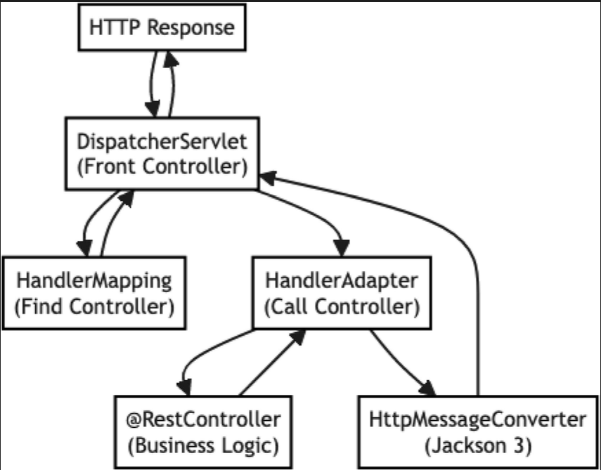
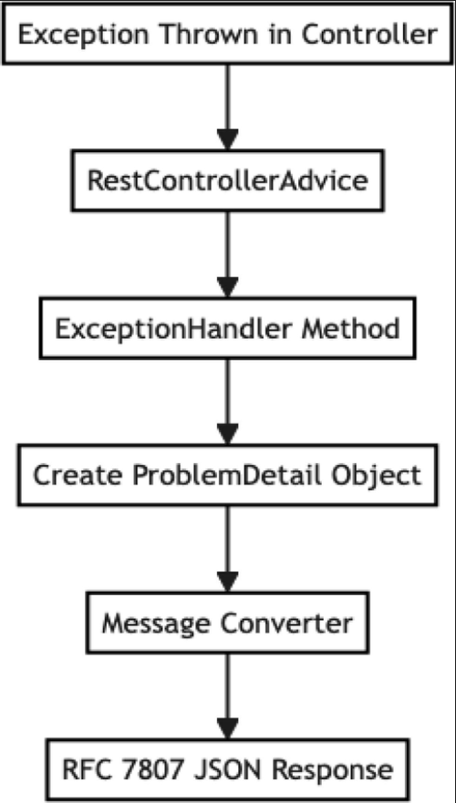

# Web Development with Spring Boot

Önceki bölümlerde, Customer CRM application'ımızın temelini attık ve Spring Boot'un çekirdek dahili yapılarını
(internals) inceledik. Şimdi, profesyonel düzeyde bir web layer'ı oluşturma zamanı. Bu bölümde, basit REST API'mizi
sağlam ve production-ready bir servise dönüştüreceğiz.

Spring Framework 7 ve Jakarta EE 11 üzerine inşa edilen Spring Boot 4, web geliştiricileri için önemli iyileştirmeler
sunmaktadır. Aşağıdakiler de dahil olmak üzere bu yeni özellikleri doğrudan inceleyeceğiz:

* Native API Versioning: Framework'ün yeni built-in desteği kullanılarak API gelişiminin yönetilmesi.

* Declarative HTTP Clients: @HttpExchange kullanılarak sıfır configuration ile external servisler için client'lar
  oluşturulması.

* Jackson 3 Integration: Java Record'larımız için en son JSON processing standartlarının kullanılması.

* The New RestTestClient: Eski MockMvc ve WebTestClient desenlerinin yerini alarak, tüm test ihtiyaçlarımız için
  birleşik ve fluent bir API'nin benimsenmesi.

Bu bölümün sonunda, yalnızca customer yönetimi için tam işlevsel bir CRUD API'ye sahip olmakla kalmayacak, aynı zamanda
modern Spring MVC mimarisi ile bakımı ve testi kolay API'lerin nasıl tasarlanacağı konusunda derin bir anlayış
kazanacaksınız.

## Infrastructure and Serialization Improvements

Spring Boot 4, performans iyileştirmeleri ve çağdaş Java özelliklerine daha iyi destek getiren modernleştirilmiş bir
stack üzerinde yer alır. Bu infrastructure değişikliklerini anlamak, framework'ün tüm gücünden yararlanmak için
elzemdir.

### Jakarta EE 11 and Servlet 6.1

Spring Boot 4, çekirdek spesifikasyonlarda önemli güncellemeler içeren Jakarta EE 11 ile uyumludur:

* Servlet 6.1: Asynchronous processing için geliştirilmiş destek ve daha verimli HTTP header handling sağlar.

* Bean Validation 3.1: Java record'ları için daha iyi destek ve daha expressive (ifade edici) constraint'ler ile
  declarative validation modelini geliştirir.

### Jackson 3: Modern JSON Processing

Varsayılan JSON processor'ı olan Jackson, sürüm 3'e yükseltildi. Bu sürüm, özellikle Spring Boot application'ları için
önemli bir adımdır:

* Netive Record Support: Jackson 3, Java 17+ record'larını kutudan çıktığı haliyle (out of the box) anlar; bunların
  unique constructor ve property access pattern'lerini daha verimli bir şekilde işler.

* ISO-8601 Defaults: Date ve time serialization artık varsayılan olarak ISO-8601 standardına geçer, böylece API'leriniz
  varsayılan olarak daha fazla interoperable (birlikte çalışabilir) hale gelir.

* Improved Performance: Jackson 3'teki mimari değişiklikler memory overhead'i azaltır ve karmaşık object graph'ları için
  serialization hızını artırır.

### Efficient Path Matching with PathPattern

Yıllarca Spring MVC, HTTP request'lerini controller method'larına mapping yapmak için AntPathMatcher'ı kullandı. Esnek
olsa da, birçok route'a sahip uygulamalar için yavaş olabiliyordu.

Spring Boot 4, varsayılan ve tek önerilen eşleşme stratejisi olarak `PathPattern`'a geçişi tamamlar. PathPattern daha
verimlidir çünkü pattern'ları başlangıçta parse eder ve cache'ler, bu da runtime'da daha hızlı request routing ile
sonuçlanır.

Spring'in daha eski sürümlerinden geçiş yapıyorsanız, bazı AntPathMatcher syntax'larının (çift yıldızın belirli
kullanımı gibi `**`) daha iyi performans ve güvenlik sağlamak amacıyla PathPattern'da biraz farklı davranabileceğini
veya kısıtlanabileceğini unutmayın.

## Spring MVC Architecture Deep Dive

Kodlamaya dalmadan önce, Spring MVC'yi güçlendiren mekanizmayı anlamak önemlidir. Spring Boot annotation'lar ile her
şeyi basit gösterse de, her HTTP request'i için arka planda iyi orkestre edilmiş bir süreç gerçekleşir.

### The Request Lifecycle

Spring MVC'nin kalbi DispatcherServlet'tir. Front controller olarak hareket eder, yani gelen tüm request'ler onun
üzerinden geçer. İşte bir request'in yolculuğu:

* Incoming Request: Bir HTTP request'i DispatcherServlet'e ulaşır.

* Handler Mapping: DispatcherServlet, istenen URL için uygun controller'ı bulması amacıyla HandlerMapping'e (PathPattern
  mantığımızla yapılandırılmış) danışır.

* Handler Adapter: Controller bulunduğunda, DispatcherServlet controller'ın method'unu fiilen call etmek için bir
  HandlerAdapter kullanır. Adapter, method argument'larını (@PathVariable veya @RequestBody gibi) çözmekten sorumludur.

* Controller Execution: Controller method'unuz çalıştırılır, genellikle bir service call eder ve bir result döndürür.

* Message Conversion: REST API'leri için (@RestController ile annotation verilmiş), dönen değer bir
  HttpMessageConverter'a (Jackson gibi) aktarılır. Bu converter, Java object'inizi (veya record'unuzu) JSON veya XML'e
  dönüştürür.

* Response: Dönüştürülen data, client'a HTTP response body'si olarak geri gönderilir.



### Annotations Uncovered

Günlük olarak kullandığımız annotation'lar sadece birer etiket olmaktan ötedir; HandlerAdapter ve DispatcherServlet için
birer talimattır.

* `@RestController`: Bu, @Controller ve @ResponseBody'nin bir birleşimidir. Spring'e bu sınıftaki her method'un bir HTML
  şablonu render etmek yerine data'yı doğrudan response body'sine döndüreceğini söyler.

* `@RequestMapping`: Bu annotation, bir method'u web handler olarak kaydeder. Dahili olarak Spring, her annotation
  eklenmiş method için başlangıçta bir RequestMappingInfo object'i oluşturur ve bu object daha sonra request'leri route
  etmek için HandlerMapping tarafından kullanılır.

* `@RequestBody`: Bu, HTTP request'inin body'sinin method parametresine deserialize edilmesi gerektiğini belirtir.
  Spring, bu büyüyü gerçekleştirmek için bir HttpMessageConverter (varsayılan olarak Jackson 3) kullanır.

* `@PathVariable`: Bu, URI şablonundan bir variable ayıklaması ve bunu method parametresine bağlaması için
  HandlerAdapter'a talimat verir.

Spring Boot 4'te bu annotation'lar, uygulama GraalVM ile native image olarak compile edildiğinde bile verimli bir
şekilde çalışmalarını sağlamak için Runtime Hint'lerden ve geliştirilmiş reflection metadata'sından yararlanır.

## RESTful API Design and Native Versioning

REST (Representational State Transfer), web API'mizin nasıl davranması gerektiğini yöneten mimari stildir. İyi bir REST
API tasarlamak; tutarlılık, öngörülebilirlik ve HTTP'nin tüm gücünden yararlanmak ile ilgilidir.

### Core REST Principles

Customer CRM API'mizi tasarlarken bu temel ilkelere uyarız:

* Resource'lar İsim Olarak: Endpoint'ler eylemleri (fiiller) değil, resource'ları (isimler) temsil etmelidir.
  `/api/v1/getCustomers` yerine `/api/v1/customers` kullanın.

* Standart HTTP Methods:

    * GET: Bir resource veya collection getirin. (Safe ve Idempotent (bir işlemin veya fonksiyonun bir kez ya da kaç kez
      arka arkaya uygulandığına bakılmaksızın, ilk seferden sonra aynı sonucu vermesi veya sistemi aynı durumda
      bırakması))

    * POST: Yeni bir resource oluşturun. (Not Safe, Not Idempotent)

    * PUT: Mevcut bir resource'u güncelleyin (Full update). (Not Safe, Idempotent)

    * PATCH: Bir resource'un bir kısmını güncelleyin. (Not Safe, Not Idempotent)

    * DELETE: Bir resource'u kaldırın. (Not Safe, Idempotent)

* Anlamlı Status Code'lar: Başarılı POST'lar için 201 Created, DELETE'ler için 204 ve bir resource mevcut olmadığında
  404 Not Found kullanın.

### API Versioning Strategy

Uygulamanız büyüdükçe, kaçınılmaz olarak API'nizi değiştirmeniz gerekecektir. Versioning, mevcut client'ları bozmadan
kırıcı değişiklikleri (breaking changes) sunmanıza olanak tanır.

Spring Boot 4 ve Spring Framework 7; çeşitli versioning stratejilerini (URL path, header, media type) destekler.
CRM'imiz için en açık (explicit) ve client'ların keşfetmesi en kolay yöntem olduğu için URL Path Versioning
kullanacağız.

Farklı API version'larımız için iki ayrı controller tanımlayacağız.

```
Version 1 (Legacy): /api/v1_1/customers Version 2 (Modern): /api/v2_0/customers
```

Bu yaklaşım, codebase'imizi temiz tutar ve muğlak mapping hatasına (ambiguous mapping errors) yol açabilecek "sihirli"
routing konfigürasyonlarından kaçınmayı sağlar.

## Implementing Full CRUD

Şimdi Customer CRM'imiz için CRUD operasyonlarının tam setini implementation yapalım. Chapter 1'de başladığımız
CustomerController'ı az önce tartıştığımız ilkelere tamamen uyumlu olacak şekilde güncelleyeceğiz.

Ayrıca geçersiz data kaydetmediğimizden emin olmak için Jakarta Validation 3.1 kullanarak Input Validation entegre
edeceğiz.

### Validating the Domain Model

Validation annotation'larını kullanmak için pom.xml dosyanıza spring-boot-starter-validation dependency'sini eklemeniz
gerekir:

```xml

<dependency>
    <groupId>org.springframework.boot</groupId>
    <artifactId>spring-boot-starter-validation</artifactId>
</dependency>
```

İlk olarak, Customer record'umuzu validation constraint'lerini içerecek şekilde güncelleyelim.

```java
public record Customer(
        UUID id,

        @NotBlank(message = "Name cannot be empty")
        String name,

        @Email(message = "Invalid email format")
        @NotBlank(message = "Email cannot be empty")
        String email,

        @Pattern(regexp = "^\\+?[0-9. ()-]{7,25}$", message = "Invalid phone number")
        String phone
) {
    public Customer(String name, String email, String phone) {
        this(null, name, email, phone);
    }
}
```

Record component'lerimizi standart Jakarta Bean Validation constraint'leri ile annotate ettik:

* `@NotBlank`: String'in null olmadığını ve kırpılmış uzunluğunun sıfırdan büyük olduğunu garanti eder. Bu, name ve
  email gibi gerekli field'lar için zorunludur.

* `@Email`: String'in geçerli bir email adresi formatını takip ettiğini doğrular (örneğin, `user@domain.com`).

* `@Pattern`: Field'a bir regular expression uygular. Burada esnek bir uluslararası telefon numarası formatını zorunlu
  kılıyoruz.

### Best Practices

* Fail Fast: Validation, geçersiz data'nın service layer'ınıza veya database'inize ulaşmasını engelleyerek kaynak
  tasarrufu sağlar ve data integrity (bütünlüğünü) garanti eder.

* Specific Messages: Her zaman custom message attribute'larını sağlayın. "Invalid email format", bir API consumer'ı için
  generic bir "must be well-formed email address" ifadesinden çok daha yararlıdır.

* DTOs vs. Entities: Daha büyük uygulamalarda, dahili domain entity'lerinizi temiz tutarak, özellikle gelen request'ler
  için tasarlanmış Data Transfer Objects (DTOs) üzerinde validation uygulamayı tercih edin.

### The Complete CustomerController

***Repository***

```java
public interface Repository<T, ID> {
    T save(T entity);

    T findById(ID id);

    Iterable<T> findAll();

    void deleteById(ID id);
}
```

***Customer Repository***

```java

@Component
public class CustomerRepository implements Repository<Customer, UUID> {
    Map<UUID, Customer> customers = new ConcurrentHashMap<>();

    @Override
    public Customer save(Customer entity) {
        Customer customer = entity;
        if (customer.id() == null) {
            customer = new Customer(
                    UUID.randomUUID(),
                    entity.name(),
                    entity.email(),
                    entity.phone()
            );
        }
        customers.put(customer.id(), customer);
        return customer;
    }

    @Override
    public Customer findById(UUID id) {
        return customers.get(id);
    }

    @Override
    public Iterable<Customer> findAll() {
        return customers.values();
    }

    @Override
    public void deleteById(UUID id) {
        customers.remove(id);
    }
}
```

***Customer Configuration***

```java

@Configuration
public class CustomerConfiguration {
    @Bean
    ApplicationListener<ApplicationReadyEvent> customerAppReady(Repository<Customer, UUID> customerRepository) {
        return event -> {
            customerRepository.save(new Customer("John", "john@example.com", "1-800-PHONE"));
            customerRepository.save(new Customer("Jane", "jane@example.com", "1-800-PHONE"));
            customerRepository.save(new Customer("Jack", "jack@example.com", "1-800-PHONE"));

            customerRepository.findAll();
        };
    }

    @Bean
    JsonMapperBuilderCustomizer jsonCustomizer() {
        return builder -> builder.enable(SerializationFeature.INDENT_OUTPUT);
    }
}
```

Şimdi, tüm HTTP verb'lerini ele alan eksiksiz controller implementation'ı burada.

```java

@RestController
@RequestMapping("/api/v1/customers")
public class CustomerController {
    private final Repository<Customer, UUID> repository;

    public CustomerController(Repository<Customer, UUID> repository) {
        this.repository = repository;
    }

    @GetMapping
    public Iterable<Customer> findAll() {
        return repository.findAll();
    }

    @GetMapping("/{id}")
    public ResponseEntity<Customer> findById(@PathVariable UUID id) {
        Customer customer = repository.findById(id);
        return customer != null ? ResponseEntity.ok(customer) : ResponseEntity.notFound().build();
    }

    @PostMapping
    public ResponseEntity<Customer> create(@Valid @RequestBody Customer customer) {
        Customer saved = repository.save(customer);
        URI location = ServletUriComponentsBuilder.fromCurrentRequest()
                .path("/{id}")
                .buildAndExpand(saved.id())
                .toUri();
        return ResponseEntity.created(location).body(saved);
    }

    @PutMapping("/{id}")
    public ResponseEntity<Customer> update(@PathVariable UUID id, @Valid @RequestBody Customer customer) {
        Customer existing = repository.findById(id);
        if (existing == null) {
            return ResponseEntity.notFound().build();
        }
        Customer toUpdate = new Customer(
                id,
                customer.name(),
                customer.email(),
                customer.phone()
        );
        repository.save(toUpdate);
        return ResponseEntity.ok(toUpdate);
    }

    @DeleteMapping("/{id}")
    public ResponseEntity<Void> delete(@PathVariable UUID id) {
        if (repository.findById(id) == null) {
            ResponseEntity.notFound().build();
        }
        repository.deleteById(id);
        return ResponseEntity.noContent().build();
    }
}
```

Burada kullanılan temel component'leri listeleyelim:

* ResponseEntity: Bu wrapper, size HTTP response'u üzerinde tam kontrol sağlar. Status code'u, header'ları ve body'yi
  ayarlamanıza olanak tanır. Örneğin, `ResponseEntity.notFound().build()` döndürmek, body olmadan bir 404 Not Found
  üretir.

* ServletUriComponentsBuilder: Bu utility, mevcut request'e göre relavite URI'lar oluşturmanıza yardımcı olur. Create
  metodunda, bunu 201 Created response'ları için bir REST best practice'ı olan Location header'ını (örneğin,
  ```http://localhost:8080/api/v1/customers/123```) oluşturmak için kullanırız.

* `@Valid`: Bu annotation, method body'si çalışmadan önce Customer object'i üzerindeki validation mantığını tetikler.
  Validation başarısız olursa Spring bir `MethodArgumentNotValidException` fırlatır.

REST standartlarına göre, yeni oluşturulan bir resource'un adresinin client'a Location header'ı ile bildirilmesi gerekir
(201 Created yanıtıyla birlikte). `URI location = ServletUriComponentsBuilder.fromCurrentRequest()` Mevcut isteğin
URL'sini (örneğin `http://localhost:8080/customers`) baz alarak bir URI yapılandırıcısı başlatır. `path("/{id}")` Mevcut
URL'nin sonuna `/{id}` ifadesini ekler (Sonuç: `http://localhost:8080/customers/{id}`).
`.buildAndExpand(savedCustomer.id())` URL içerisindeki `{id}` kısmını, veritabanına kaydedilen müşterinin ID değeriyle
değiştirir (Not: Burada `savedCustomer.id()` kullanımı, Customer sınıfının bir Java record olduğunu gösterir).
``.toUri();`` Oluşturulan bu adres yapısını standart bir Java URI nesnesine dönüştürür.

`return ResponseEntity.created(location).body(savedCustomer);` `ResponseEntity.created(location)`: HTTP 201 Created
status kodunu döner ve yanıt başlığına (Location header) yeni kaynağın erişim adresini ekler. `.body(savedCustomer)`:
Yanıtın gövdesine ise veritabanına kaydedilen ve ID'si oluşmuş olan müşteri nesnesini ekleyerek istemciye geri gönderir.

***Best Practices***

* Idempotency: PUT ve DELETE operasyonlarının idempotent olduğundan emin olun. Bunları aynı ID ile birden fazla kez call
  etmek aynı etkiye sahip olmalıdır (veya en azından tutarsız state'lere neden olmamalıdır).

* Status Codes: Sadece 200 OK yerine özel status code'lar (201 Created, 204 No Content) kullanın. Bu, API'nizi anlamsal
  olarak daha zengin ve client'ların kullanması için daha kolay hale getirir.

* Resource Identification: URL path'indeki ID'ler için (resource'u belirlemek amacıyla) `@PathVariable` ve karmaşık data
  için (resource state'i) `@RequestBody` kullanın.

## Exception Handling and Content Negotiation

Profesyonel bir API, hatayı zarif bir şekilde ele almalı ve client'a anlamlı message'lar döndürmelidir. Ayrıca farklı
data format'larını destekleyecek kadar esnek olmalıdır.

### Global Exception Handling with @ControllerAdvice

Her controller method'una try-catch block'ları eklemek yerine, Spring, @ControllerAdvice annotation'ını kullanarak
exception'ları global olarak ele almanıza olanak tanır. Bu, tüm uygulamanız genelinde tutarlı bir error response yapısı
sağlar.

Spring Boot 4'te, error response'ları için önerilen standart HTTP API'leri için Problem Details'tir (RFC 7807).

```java

@RestControllerAdvice
public class GlobalExceptionHandler {
    @ExceptionHandler(MethodArgumentNotValidException.class)
    public ProblemDetail handleValidationException(MethodArgumentNotValidException ex) {
        ProblemDetail detail =
                ProblemDetail.forStatusAndDetail(HttpStatus.BAD_REQUEST, "Validation failed");
        String errors = ex.getBindingResult().getFieldErrors().stream()
                .map(error ->
                        error.getField() + ": " + error.getDefaultMessage()
                ).collect(Collectors.joining(", "));
        detail.setTitle("Invalid Request Content");
        detail.setProperty("Error", errors);
        return detail;
    }

    @ExceptionHandler(NoResourceFoundException.class)
    public ProblemDetail handleNotFoundException(NoResourceFoundException ex) {
        ProblemDetail detail =
                ProblemDetail.forStatusAndDetail(HttpStatus.NOT_FOUND, "The requested resource not found");
        detail.setTitle("Resource not found");
        detail.setType(URI.create("https://api.crm.com/errors/not-found"));
        return detail;
    }
}
```

Burada ne olduğunu adım adım inceleyelim:

* `@RestControllerAdvice`: Bu, uygulamanız genelindeki tüm `@RequestMapping` methodlarına global olarak uygulanan
  `@ExceptionHandler` methodlarını tanımlamanıza olanak tanıyan bir `@Component` özel durumudur. Geleneksel yöntemde,
  her `@RestController` sınıfı içinde kendi hatalarınızı yakalamak için `@ExceptionHandler` yazabilirsiniz. Ancak bir
  projede yüzlerce controller olabilir. `@RestControllerAdvice` tam bu noktada devreye girer: Uygulamanın herhangi bir
  yerinde fırlatılan bir hatayı merkezi bir noktada yakalar ve client'a uygun bir JSON response döner.
  `@ControllerAdvice` : Hata sonrası genellikle bir HTML/JSP sayfası (View) döndürmek istendiğinde kullanılır (Monolitik
  yapılar). `@RestControllerAdvice: @ControllerAdvice + @ResponseBody` birleşimidir. Hata yanıtını doğrudan JSON veya
  XML olarak döner (REST API'ler için standarttır).

* `@ExceptionHandler`: Bu annotation, belirli bir methodun değerinde listelenen type (lar)daki exception'ları handle
  ettiğini declare eder. Özetle: `@RestControllerAdvice` bir kapsayıcı/çatı ise, `@ExceptionHandler` onun içindeki
  spesifik işçilerdir. Bir metodun üzerine `@ExceptionHandler(Errorclass.class)` eklediğinizde Spring'e şunu demiş
  olursunuz: "Eğer uygulama çalışırken Errorclass (veya onun alt sınıflarından biri) fırlatılırsa, akışı kes ve kontrolü
  doğrudan bu metoda ver." Anotasyonun value parametresine tek bir hata veya birden fazla hata türü verebilirsiniz:
  `@ExceptionHandler({NullPointerException.class, IllegalArgumentException.class})`

* Triggers:

    * MethodArgumentNotValidException: @Valid ile annotation eklenmiş bir bağımsız argument üzerindeki validation
      başarısız olduğunda Spring tarafından otomatik olarak fırlatılır.

    * NoResourceFoundException: Belirli bir request path'i için bir handler bulunamadığında (örneğin bir 404)
      fırlatılır.

    * ProblemDetail: Spring Framework 6 ile sunulan bu sınıf, RFC 7807 spesifikasyonunun standart bir
      representation'ıdır.
      type, title, status, detail ve instance gibi field'lar dahil olmak üzere hatalar için standardize edilmiş bir JSON
      yapısı sağlar. Bizim errors field'ımız gibi custom properties (uzantılar) da ekleyebilirsiniz.



### Best practices

* Standardize Errors: Her zaman tutarlı bir hata formatı döndürün. RFC 7807'yi (Problem Details) benimsemek, API'nizin
  birçok modern client'ın halihazırda anladığı evrensel bir hata dilini konuşmasını sağlar.

* Don’t Leak Internals: Hata mesajlarınızda yığın izlerini (stack trace) veya hassas internal detayları açığa
  çıkarmamaya dikkat edin. detail field'ı açıklayıcı ancak safe olmalıdır.

* Use Specific Exceptions: generic bir Exception veya RuntimeException yerine belirli istisnaları
  (CustomerNotFoundException gibi) yakalayın. Bu, en uygun HTTP status code'unu (örneğin 404'e karşı 500) döndürmenize
  olanak tanır.

API tasarımı ve sürdürülebilirlik açısından NoResourceFoundException'ı customer bulunamadı durumu için kullanmak yerine
ayrı bir CustomerNotFoundException yazmak çok daha doğru bir yaklaşımdır. NoResourceFoundException, Spring Framework'ün
altyapısına ait bir exception'dır. Genellikle kullanıcı var olmayan bir URL'ye `(/api/v1/yanlis-adres)` istek attığında
Spring tarafından otomatik fırlatılır. CustomerNotFoundException ise business logic'e (domain) aittir. URL doğrudur,
endpoint mevcuttur ancak veritabanında o ID'ye sahip bir customer yoktur. Bu ikisini karıştırmak mimari katmanları
birbirine bağlar. NoResourceFoundException standart ve genel bir mesaj döner: "The requested resource not found". Özel
bir CustomerNotFoundException kullandığında ise mesajı özelleştirebilirsin: "ID'si 42 olan customer sistemde
bulunamadı". Bu, API'yi kullanan frontend geliştiricinin veya istemcinin hatayı çok daha hızlı çözmesini sağlar.

```java
public class CustomerNotFoundException extends RuntimeException {
    public CustomerNotFoundException(String message) {
        super(message);
    }
}
```

GlobalExceptionHandler;

```java
@RestControllerAdvice
public class GlobalExceptionHandler {
    @ExceptionHandler(MethodArgumentNotValidException.class)
    public ProblemDetail handleValidationException(MethodArgumentNotValidException ex) {
        ProblemDetail detail =
                ProblemDetail.forStatusAndDetail(HttpStatus.BAD_REQUEST, "Validation failed");
        String errors = ex.getBindingResult().getFieldErrors().stream()
                .map(error ->
                        error.getField() + ": " + error.getDefaultMessage()
                ).collect(Collectors.joining(", "));
        detail.setTitle("Invalid Request Content");
        detail.setProperty("Error", errors);
        return detail;
    }

    @ExceptionHandler(NoResourceFoundException.class)
    public ProblemDetail handleNotFoundException(NoResourceFoundException ex) {
        ProblemDetail detail =
                ProblemDetail.forStatusAndDetail(HttpStatus.NOT_FOUND, "The requested resource not found");
        detail.setTitle("Resource not found");
        detail.setType(URI.create("https://api.crm.com/errors/not-found"));
        return detail;
    }

    @ExceptionHandler(CustomerNotFoundException.class)
    public ProblemDetail handleCustomerNotFoundException(CustomerNotFoundException ex) {
        ProblemDetail detail =
                ProblemDetail.forStatusAndDetail(HttpStatus.NOT_FOUND, ex.getMessage());
        detail.setTitle("Customer not found");
        detail.setType(URI.create("https://api.crm.com/errors/customer-not-found"));
        return detail;
    }
}
```

### Content Negotiation

Varsayılan olarak API'miz JSON döndürür. Ancak bazı client'lar XML'i tercih edebilir. Spring MVC, Content Negotiation
aracılığıyla birden fazla formatı desteklemeyi kolaylaştırır.

XML'i desteklemek için öncelikle Jackson XML uzantısını dependency'lerinize eklemeniz gerekir:

```xml

<dependency>
    <groupId>com.fasterxml.jackson.dataformat</groupId>
    <artifactId>jackson-dataformat-xml</artifactId>
</dependency>
```

Bu dependency mevcut olduğunda, Spring Boot otomatik olarak XML için bir HttpMessageConverter configure eder. Bir client
artık bir Accept: application/xml header'ı göndererek XML request'inde bulunabilir.

Bu behavior'ı bir test ile doğrulayabiliriz:

```java

@SpringBootTest(webEnvironment = SpringBootTest.WebEnvironment.RANDOM_PORT)
@AutoConfigureRestTestClient
public class ContentNegotiationTests {
    private static final String APPLICATION_XML_UTF8_VALUE = "application/xml;charset=UTF-8";

    @Autowired
    private RestTestClient client;

    @Test
    void shouldReturnJsonByDefault() {
        client.get()
                .uri("/api/v1/customers")
                .exchange()
                .expectStatus().isOk()
                .expectHeader().contentType(MediaType.APPLICATION_JSON)
                .expectBody(Customer[].class)
                .consumeWith(entityExchangeResult -> {
                    Customer[] customers = entityExchangeResult.getResponseBody();
                    assertThat(customers).isNotNull();
                    for (Customer customer : customers) {
                        assertThat(customer.id()).isNotNull();
                    }
                });
    }

    @Test
    void shouldReturnXMLByDefault() {
        client.get()
                .uri("/api/v1/customers")
                .accept(MediaType.APPLICATION_XML)
                .exchange()
                .expectStatus().isOk()
                .expectHeader().contentType(APPLICATION_XML_UTF8_VALUE)
                .expectBody(Customer[].class)
                .consumeWith(entityExchangeResult -> {
                    Customer[] customers = entityExchangeResult.getResponseBody();
                    assertThat(customers).isNotNull();
                    for (Customer customer : customers) {
                        assertThat(customer.id()).isNotNull();
                    }
                });
    }
}
```

### Best Practices:

* Prefer JSON: JSON, modern API'ler için facto standarttır. Default format olarak tutun.

* Use Standard Media Types: Çok özel bir ihtiyacınız olmadığı sürece özel türler yerine her zaman standart medya
  türlerini (application/json veya application/xml gibi) kullanın.

* Test Multiple Formats: API'niz birden fazla formatı destekliyorsa, serialization regressions (gerilemelerini) önlemek
  için automated test'lerinizin hepsini kapsadığından emin olun.

## Declarative HTTP Service Clients

Spring Boot 4, @HttpExchange annotation'ı ve @ImportHttpServices mekanizmasını kullanarak external REST servisleri için
client'ların oluşturulmasını kolaylaştırır. Bu, client'ınızı basit bir Java interface'i olarak tanımlamanıza olanak
tanır. Mikroservisler veya 3. parti REST API'ler ile haberleşmeyi son derece kolaylaştıran yeni declaratif HTTP Client
özelliğidir. Aslında bu konsept Spring Boot 3.0 ve Spring Framework 6.0 ile hayatımıza giren `@HttpExchange` ve Spring
Boot 3.2+ / 3.4+ sürümleriyle gelişip otomatikleşen mekanizmanın özetidir.

### Consuming External APIs

CRM'imizin customer değerini farklı para birimlerinde görüntülemek için döviz kurlarını getirmesi gerektiğini hayal
edelim. Gerçek zamanlı data almak için ücretsiz Exchange Rate API'sini (open.er-api.com) kullanacağız. Bir
CurrencyClient interface'i tanımlayabiliriz:

```java

@HttpExchange("https://open.er-api.com/v6/latest")
public interface CurrencyClient {
    @GetExchange("/{base}")
    Map<String, Object> getRates(@PathVariable String base);
}
```

Bu interface'de:

* `@HttpExchange("/v6/latest")`: type düzeyindeki bu annotation, bu interface'deki tüm methodlar için base path'i
  tanımlar. Spring'e bu interface'in bir HTTP servisini represent ettiğini söyler.

* `@GetExchange("/{base}")`: Bu annotation, getRates yöntemini bir HTTP GET request'ine map eder. `{base}`
  placeholder'ı, @PathVariable ile annotate edilmiş method argümanına bind edilir.

### Best Practices:

* Interface Segregation: Herşey için tek bir devasa client yerine, belirli external servisler için küçük, odaklanmış
  client interface'leri oluşturun.

* Return Types: ResponseEntity, Mono/Flux (reactive için) veya basit POJO'lar/Map'ler döndürebilirsiniz. JSON
  response'unu map etmek için Record'ları kullanmak genellikle en temiz yaklaşımdır.

Bu client'ı enable etmek için configuration'ımızda `@ImportHttpServices` kullanırız. Full URL'yi interface'de
tanımladığımız için ekstra bir client configuration'ına gerek kalmaz.

```java

@Configuration
@ImportHttpServices(CurrencyClient.class)
public class ClientConfig {
}
```

* `@ImportHttpServices`: Bu annotation, CurrencyClient için proxy implementation'ının oluşturulmasını tetikler. Spring,
  arka planda gerekli RestClient'ı otomatik olarak oluşturur.

Best Practices:

* Externalize URLs: Basitlik adına URL'yi burada hardcode etmiş olsak da, gerçek bir uygulamada bunu
  `application.properties`'ten yüklemek için `@HttpExchange` annotation'ında bir placeholder (örneğin
  `@HttpExchange ("${currency.api.url}"))` kullanmalısınız.

* Timeouts: Timeout'ları global olarak configure etmek için özel bir RestClientCustomizer bean'i tanımlayabilirsiniz.

### Testing the Declarative Client

Declarative client'ımızı mock bir sunucu kullanarak veya gerçek API'ye istek atarak (integration testleri için) test
edebiliriz. Nasıl çalıştığını doğrulamak için yapabilecekleriniz:

```java

@SpringBootTest
public class CurrencyClientTest {
    @Autowired
    private CurrencyClient currencyClient;

    @Test
    void shouldRetrieveExchangeRates() {
        Map<String, Object> response = currencyClient.getRates("USD");
        assertThat(response).containsKey("rates");
        assertThat(response.get("base_code")).isEqualTo("USD");
        Map<String, Double> rates = (Map<String, Double>) response.get("rates");
        assertThat(rates).containsKey("EUR");
    }
}
```

## Unified Testing with RestTestClient

Web katmanlarını test etmek geleneksel olarak MockMvc (unit testler için) ve WebTestClient (integration testler için)
arasında seçim yapmayı gerektirmiştir. Spring Boot 4, tüm senaryolar için tutarlı ve akıcı bir API sunan birleşik bir
araç olan RestTestClient'ı sunar.

### Unit Testing with bindToController

CustomerController bileşenini izole bir şekilde test etmek için RestTestClient'ı doğrudan ona bind edebiliriz.

```java

public class CustomerControllerTest {
    private final RestTestClient client = RestTestClient
            .bindToController(new CustomerController(new CustomerRepository()))
            .build();

    @Test
    void shouldReturnAllCustomers() {
        client.get()
                .uri("/api/v1/customers")
                .exchange()
                .expectStatus().isOk()
                .expectBody(Customer[].class)
                .value(customers -> assertThat(customers).isEmpty());
    }
}
```

RestTestClient içinde bind ("bağlamak"), test client'inin request'leri nereye veya hangi ortama göndereceğini belirlemek
demektir. RestTestClient tek başına gerçek bir ağ isteği atan ya da kendi içinde server barındıran bir nesne değildir;
ona bir hedef ("sunucu" veya sahte/mock katman) bağlamanız gerekir.

`RestTestClient.bindToController(new CustomerController(new CustomerRepository()))` satırı: Gerçek bir HTTP sunucusu
(Tomcat vb.) ayağa kaldırmaz ve tüm Spring context'ini yüklemez. Arka planda sahte (mock) request ve response nesneleri
üzerinden doğrudan verdiğiniz CustomerController örneğine request yönlendirir. Bu sayede controller endpoint'lerinizi
(örneğin `GET /customers`) çok hızlı bir şekilde test edebilirsiniz.

* `bindToController(...)` : Sadece ilgili controller'ı izole ve en hızlı biçimde test etmek için.

* `bindToApplicationContext(...)` : Tüm Spring context'i (servisler, bean'ler vb.) ile ama gerçek HTTP portu açmadan
  test yapmak için.

* `bindToServer()` : Çalışan gerçek bir HTTP sunucusuna (örneğin localhost:port) istek atarak uçtan uca test yapmak
  için.

customers array'inin boş (isEmpty()) beklenmesinin sebebi, test sırasında oluşturduğunuz new CustomerRepository()
nesnesinin içinde henüz hiçbir kayıt bulunmamasıdır. Unit / controller testlerinde her test metodu temiz bir başlangıç
durumuyla çalışır. Önce veri eklenmemişse (veya constructor/seed ile hazır veri yüklenmemişse) GET `/api/v1/customers`
çağrısı boş liste [] döndürür ve `Customer[].class` olarak deserialize edildiğinde boş dizi (length == 0) olur.

CustomerConfiguration içinde John, Jane ve Jack'i ekleyen bean'in bulunmasına rağmen testte customers listesinin boş
(isEmpty()) gelmesinin nedeni, `RestTestClient.bindToController(...)` yaklaşımının Spring ApplicationContext ve
ApplicationReadyEvent olayını tetiklememesidir. bindToController(...) izole çalışır: Bu yöntem yalnızca tek bir
controller sınıfını ayağa kaldırır. `@Configuration` sınıfını okumaz, bean'leri oluşturmaz ve ApplicationReadyEvent
fırlatmaz. Dolayısıyla John, Jane ve Jack kayıtları test sırasında hiç eklenmez.

### Integration Testing with bindToServer

Full-stack integration test için RestTestClient'ı çalışan sunucuya bind ederiz.

```java

@SpringBootTest(webEnvironment = SpringBootTest.WebEnvironment.RANDOM_PORT)
@AutoConfigureRestTestClient
public class CustomerIntegrationTest {
    @Autowired
    RestTestClient client;

    @Test
    void shouldCreateCustomer() {
        Customer customer = new Customer(
                "John Doe",
                "john.doe@example.com",
                "123456789"
        );
        var result = client.post()
                .uri("/api/v1/customers")
                .body(customer)
                .exchange()
                .expectStatus().isCreated()
                .expectHeader().exists("Location")
                .returnResult(Void.class);

        String location = result.getResponseHeaders().getFirst("Location");
        System.out.println(location); // http://localhost:57328/api/v1/customers/40451e6f-d59b-44aa-bef5-20149a47b3f9
    }
}
```

Bu testte gerçek bir HTTP sunucusu ve tüm Spring Boot uygulaması ayağa kaldırılarak uçtan uca bir entegrasyon testi
(integration test) yapılıyor. Önceki bindToController yaklaşımından farkı, controller'ı tek başına sahte bir ortamda
değil; gerçek bean'ler, konfigürasyonlar ve rastgele bir portta çalışan web katmanıyla birlikte test etmesidir. REST API
tasarımında yeni bir kayıt 201 Created koduyla oluşturulduğunda, sunucunun yanıt başlıklarına (HTTP response header)
`Location` başlığı eklemesi standart bir pratiktir.

POST `/api/v1/customers` isteği sonrasında 201 Created dönerken yanıt gövdesinde (body) bir nesne beklemiyor veya
gövdeyi belirli bir Java sınıfına dönüştürmek (deserialize etmek) istemiyorsanız `Void.class` verilir.

## A Robust Customer CRM

Spring Boot 4’ün web yeteneklerinin gücünü gerçek anlamda göstermek için, her şeyi gerçek dünya senaryosunda bir araya
getirelim. CRM'imizin basit, esnek bir API (Version 1) ile başladığını hayal edin, ancak artık sıkı bir data bütünlüğü
ve gelişmiş profil bilgisi (Version 2) gerektiriyor. Client'ların kendi hızlarında geçiş yapabilmesi için her ikisini de
aynı anda desteklememiz gerekiyor.

### Defining the Data Models

Öncelikle, Customer resource'un iki sürümünü tanımlıyoruz.

Version 1 (Legacy): Basit ve esnek. Validation mantığı yok.

```java
public record CustomerV1(UUID id, String name, String email) {
}
```

Version 2 (Modern):

```java
public record CustomerV2(
        UUID id,

        @NotBlank(message = "Title is required")
        String title,

        @NotBlank(message = "Name is required")
        String name,

        @NotBlank @Email(message = "Invalid email")
        String email
) {
}
```

### Versioned Repositories

Following versioning stratejimiz doğrultusunda, repository'lerimizi de ayırıyoruz. Bu, gerektiğinde farklı data
persistence mantığını yönetmemize olanak tanır.

Repository V1: Simple storage for legacy data.

```java

@Repository
public class CustomerRepositoryV1 {
    private final Map<UUID, CustomerV1> customers = new ConcurrentHashMap<>();

    public CustomerV1 save(CustomerV1 customer) {
        UUID id = customer.id() != null ? customer.id() : UUID.randomUUID();
        CustomerV1 toSave = new CustomerV1(
                id,
                customer.name(),
                customer.email()
        );
        customers.put(id, toSave);
        return toSave;
    }
}
```

Repository V2: Enhanced storage for modern data, including the title.

```java

@Repository
public class CustomerRepositoryV2 {
    private final Map<UUID, CustomerV2> customers = new ConcurrentHashMap<>();

    public CustomerV2 save(CustomerV2 customer) {
        UUID id = customer.id() != null ? customer.id() : UUID.randomUUID();
        CustomerV2 toSave = new CustomerV2(
                id,
                customer.title(),
                customer.name(),
                customer.email()
        );
        customers.put(id, toSave);
        return toSave;
    }
}
```

### Versioned Controllers

Şimdi controller'ları implement ediyoruz. Her controller'ın ilgili repository'sini nasıl inject ettiğine dikkat edin.

CustomerControllerV1:

```java

@RestController
@RequestMapping("/api/v1_1/customers")
public class CustomerControllerV1 {
    private final CustomerRepositoryV1 repository;

    public CustomerControllerV1(CustomerRepositoryV1 repository) {
        this.repository = repository;
    }

    @PostMapping
    public ResponseEntity<CustomerV1> create(@RequestBody CustomerV1 customer) {
        // Legacy behavior: accepts anything, minimal checks
        CustomerV1 saved = repository.save(customer);
        return ResponseEntity
                .status(HttpStatus.CREATED)
                .body(saved);
    }
}
```

CustomerControllerV2:

```java

@RestController
@RequestMapping("/api/v2_0/customers")
public class CustomerControllerV2 {
    private final CustomerRepositoryV2 repository;

    public CustomerControllerV2(CustomerRepositoryV2 repository) {
        this.repository = repository;
    }

    @PostMapping
    public ResponseEntity<CustomerV2> create(@Valid @RequestBody CustomerV2 customer) {
        // Modern behavior: Strict validation handled by GlobalExceptionHandler
        CustomerV2 saved = repository.save(customer);
        return ResponseEntity
                .status(HttpStatus.CREATED)
                .body(saved);
    }
}
```

Bir client `/api/v2_0/customers` adresine geçersiz data gönderirse, `MethodArgumentNotValidException` fırlatılacaktır.
(Daha önce tanımladığımız) GlobalExceptionHandler bunu yakalar ve yapılandırılmış bir ProblemDetail JSON response döner.
Eğer bunu `/api/v1_1/customers` adresine gönderirlerse, (muhtemelen bad data saklayarak) başarılı olur ve geriye dönük
uyumluluğu (backward compatibility) korur.

### Verifying the Migration

RestTestClient kullanarak bu ikili davranışı doğrulayabiliriz. Bu test, application'ımızın esnek eski API ile katı
modern API'yi doğru şekilde ayırt ettiğini kanıtlar.

```java

@SpringBootTest(webEnvironment = SpringBootTest.WebEnvironment.RANDOM_PORT)
@AutoConfigureRestTestClient
public class CustomerVersioningTests {
    @Autowired
    private RestTestClient client;

    @Test
    void testLegacyVsModernApi() {
        // 1. Legacy API (V1) - Accepts Invalid Email
        CustomerV1 badDataV1 = new CustomerV1(null, "John", "not-an-email");
        client.post()
                .uri("/api/v1_1/customers")
                .body(badDataV1)
                .exchange()
                .expectStatus().isCreated();

        // 2. Modern API (V2) - Rejects Invalid Email
        CustomerV2 badDataV2 = new CustomerV2(null, "Mr.", "John", "not-an-email");
        client.post()
                .uri("/api/v2_0/customers")
                .body(badDataV2)
                .exchange()
                .expectStatus().isBadRequest()
                .expectBody()
                .jsonPath("$.detail").isEqualTo("Validation failed")
                .jsonPath("$.errors").value(errors ->
                        assertThat(errors.toString()).contains("Invalid email")
                );

        // 3. Modern API (V2) - Accepts Valid Data with Title
        CustomerV2 validDataV2 = new CustomerV2(null, "Dr.", "Jane Doe", "jane@example.com");
        client.post()
                .uri("/api/v2_0/customers")
                .body(validDataV2)
                .exchange()
                .expectStatus().isCreated()
                .expectBody(CustomerV2.class)
                .value(c -> assertThat(c.title()).isEqualTo("Dr."));
    }
}
```

Bu kapsamlı test suite'i, CRM'imizi geliştirirken, yeniler için daha yüksek standard'lar uygular (enforce ederken)
mevcut integration'ları bozmamamızı sağlar.

Sağlam bir web layer yerindeyken, bellek içi depolamanın (in-memory storage) ötesine geçmeye hazırız. Bir sonraki
chapter'da, JDBC ile başlayarak ve Spring Boot'un database etkileşimlerini nasıl sorunsuz hale getirdiğini keşfederek
Relational Data Access konusuna dalacağız.