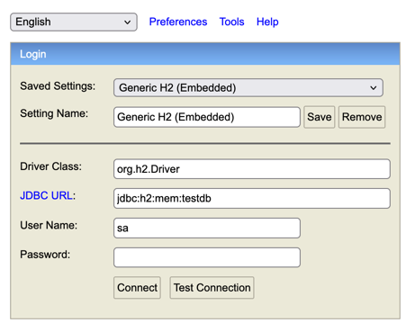
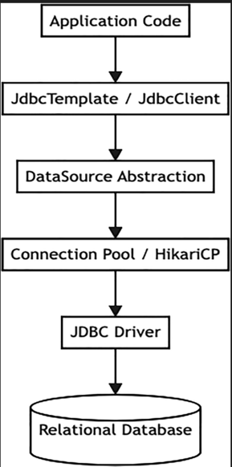

# JDBC with Spring Boot

Önceki bölümde, customer uygulamamız için sağlam bir web layer inşa ettik ancak verilerimiz yalnızca bellekte yaşıyordu.
Uygulama durduğu anda customer verilerimiz kayboluyordu. Bu bölümde, persistence layer inşa ederek uygulamamızın
verileri ilişkisel bir veritabanında güvenilir şekilde saklamasını sağlayacağız.

Spring Boot’un güçlü JDBC (Java Database Connectivity) desteğini keşfedecek, klasik JdbcTemplate’den modern ve akıcı
JdbcClient’a geçeceğiz. Ayrıca hızlı testler için in-memory bir veritabanı ve production benzeri simülasyon için gerçek
bir PostgreSQL veritabanı kullanarak gerçekçi bir geliştirme ortamı kuracağız.

## Project Setup and Dependencies

Veritabanlarıyla çalışmaya başlamak için projemize JDBC Starter’ı eklememiz gerekir. Bu starter, connection pooling
(HikariCP) ve transaction yönetimi için gerekli kütüphaneleri beraberinde getirir.

İki database driver'ını da dahil edeceğiz:

1. H2 Database: Development ve testing için mükemmel bir in-memory database.

2. PostgreSQL: Production ortamımız için güçlü, open-source bir relational database.

```xml
<dependencies>
    <dependency>
        <groupId>org.springframework.boot</groupId>
        <artifactId>spring-boot-starter-jdbc</artifactId>
    </dependency>
    <dependency>
        <groupId>org.springframework.boot</groupId>
        <artifactId>spring-boot-starter-webmvc</artifactId>
    </dependency>
    <dependency>
        <groupId>org.springframework.boot</groupId>
        <artifactId>spring-boot-starter-validation</artifactId>
    </dependency>
    <dependency>
        <groupId>com.h2database</groupId>
        <artifactId>h2</artifactId>
        <scope>runtime</scope>
    </dependency>
    <dependency>
        <groupId>org.springframework.boot</groupId>
        <artifactId>spring-boot-h2console</artifactId>
    </dependency>
    <dependency>
        <groupId>org.postgresql</groupId>
        <artifactId>postgresql</artifactId>
        <scope>runtime</scope>
    </dependency>
    <dependency>
        <groupId>org.springframework.boot</groupId>
        <artifactId>spring-boot-starter-jdbc-test</artifactId>
        <scope>test</scope>
    </dependency>
    <dependency>
        <groupId>org.springframework.boot</groupId>
        <artifactId>spring-boot-starter-webmvc-test</artifactId>
        <scope>test</scope>
    </dependency>
</dependencies>
```

* `spring-boot-starter-jdbc` : Bu temel dependency’dir. DataSource’u, transaction yöneticisini
  (DataSourceTransactionManager) ve JdbcTemplate bean’lerini otomatik olarak yapılandırır.

* `spring-boot-starter-jdbc-test` : Spring Boot 4’teki modüler test yaklaşımını izleyerek, `@JdbcTest` annotation dahil
  olmak üzere JDBC odaklı testler için gereken özel otomatik yapılandırmayı ve dependency’leri sağlar.

* `<scope>runtime</scope>` : Veritabanı sürücülerini runtime scope olarak declare ederiz çünkü kodumuz veritabanına özgü
  sınıflarla değil, standart JDBC interface’leriyle (DataSource gibi) etkileşime girmelidir. Bu decoupling,
  veritabanlarını kolayca değiştirmemizi sağlar.

### Database Initialization with schema.sql

Spring Boot’un veritabanı şemanızı başlatmak için built-in bir özelliği vardır. Classpath’inizin root dizinine
`(src/main/resources)` schema.sql adlı bir dosya yerleştirirseniz, Spring Boot bunu başlangıçta otomatik olarak algılar
ve çalıştırır. Customer tablomuzu tanımlayalım. `src/main/resources/schema.sql` dosyasını oluşturun:

```h2
CREATE TABLE IF NOT EXISTS customer
(
    id    UUID primary key,
    name  VARCHAR(255) NOT NULL,
    email VARCHAR(255) NOT NULL UNIQUE,
    phone VARCHAR(50)
);
```

***Best Practices***

* Idempotency: Başlatma script’lerinizde her zaman IF NOT EXISTS (veya benzer yapıları) kullanın; böylece tablo zaten
  mevcutsa hata vermeden her başlangıçta güvenle çalışabilirler.

* Version Control: Şemanızı SQL dosyalarında tutmak, veritabanı yapınızın kodunuzla birlikte versioned olmasını sağlar
  ve deployment’ları predictable kılar.

## Developing with H2 and the Console

Local development için H2 veritabanı son derece kullanışlıdır. Classpath’imizde h2 bulunduğu için Spring Boot bizim için
otomatik olarak bir in-memory datasource yapılandırır `(jdbc:h2:mem:…)`.

Bu memory veritabanının içindeki verileri incelemek için Spring Boot, web tabanlı bir database client'i olan H2
Console’u sağlar. Güvenlik nedeniyle varsayılan olarak devre dışıdır, bu yüzden onu etkinleştirmemiz gerekir.

`src/main/resources/application.properties` dosyanıza aşağıdakileri ekleyin:

```properties
spring.h2.console.enabled=true
spring.h2.console.path=/h2-console
spring.datasource.url=jdbc:h2:mem:testdb
spring.datasource.username=sa
spring.datasource.password=
```

Şimdi, uygulamanızı çalıştırdığınızda http://localhost:8080/h2-console adresine gidebilirsiniz.



Connect’e tıklayın ve schema.sql script’i tarafından oluşturulan CUSTOMER tablonuzu göreceksiniz.

## Going Production-Ready with PostgreSQL

H2 hızlı testler için harika olsa da “Pro” bir uygulama gerçek bir database motoruna ihtiyaç duyar. Docker Compose
kullanarak kolayca bir PostgreSQL instance ayağa kaldırabiliriz.

Projenizin root dizininde bir `docker-compose.yml` dosyası oluşturun:

```yml

services:
  postgres:
    image: postgres:latest
    environment:
      POSTGRES_DB: crm
      POSTGRES_USER: crm_user
      POSTGRES_PASSWORD: secret_password
    ports:
      - "5432:5432"
```

Uygulamamızı H2 yerine bu veritabanına bağlamak için bir prod profile tanımlayabiliriz.
`src/main/resources/application-prod.properties` dosyasını oluştur:

```properties
spring.datasource.url=jdbc:postgresql://localhost:5432/crm
spring.datasource.username=crm_user
spring.datasource.password=secret_password
spring.sql.init.mode=always
```

Artık uygulamanı production profile ile çalıştırabilirsin: `./mvnw spring-boot:run -Dspring-boot.run.profiles=prod`

Spring Boot, PostgreSQL driver'ını ve geçerli URL'yi algılayacak ve in-memory H2 yerine Docker'a bağlanmak için
DataSource'u otomatik olarak değiştirecektir.

## The Classic Approach: JdbcTemplate

JdbcTemplate, on yılı aşkın süredir veritabanı erişimini basitleştiren klasik Spring abstraction'ıdır. JDBC'nin "kirli
işlerini" üstlenir: bağlantıları açmak, statement'ları hazırlamak, result set'ler üzerinde gezinmek ve—en
önemlisi—sızıntıları önlemek için her şeyi düzgün bir şekilde kapatmak. Ayrıca anlaşılması güç SQL exception'larını
Spring'in okunabilir DataAccessException hiyerarşisine dönüştürür.



### Mapping Rows to Records

Query yapmadan önce, bir SQL ResultSet row'unu Customer Java record'umuza dönüştürmenin bir yoluna ihtiyacımız var. Bunu
yapmak için RowMapper interface'ini implement ederiz.

```java
public record Customer(
        UUID id,

        @NotBlank(message = "Name cannot be empty")
        String name,

        @Email(message = "Invalid email format")
        @NotBlank(message = "Email cannot be empty")
        String email,

        @Pattern(regexp = "^\\+?[0-9. ()-]{7,25}$", message = "Invalid phone number")
        String phone
) {
    public Customer(String name, String email, String phone) {
        this(null, name, email, phone);
    }
}
```

```java
public class CustomerRowMapper implements RowMapper<Customer> {
    @Override
    public Customer mapRow(ResultSet rs, int rowNum) throws SQLException {
        return new Customer(
                UUID.fromString(rs.getString("id")),
                rs.getString("name"),
                rs.getString("email"),
                rs.getString("phone")
        );
    }
}
```

### Implementing the Repository

```java
public interface Repository<T, ID> {
    T save(T entity);

    T findById(ID id);

    Iterable<T> findAll();

    void deleteById(ID id);
}
```

Şimdi CustomerRepository'mizi JdbcTemplate kullanarak implement ediyoruz. Template'i constructor üzerinden nasıl inject
ettiğimize dikkat et; Spring Boot bu bean'i bizim için zaten configure etti.

```java
public class CustomerRepository implements Repository<Customer, UUID> {
    private final JdbcTemplate jdbcTemplate;
    private final CustomerRowMapper rowMapper = new CustomerRowMapper();

    public CustomerRepository(JdbcTemplate jdbcTemplate) {
        this.jdbcTemplate = jdbcTemplate;
    }

    @Override
    public Customer findById(UUID id) {
        String query = "SELECT * FROM customer WHERE id=?";
        List<Customer> result = jdbcTemplate.query(query, rowMapper, id);
        return result.stream().findFirst().orElse(null);
    }

    @Override
    public Iterable<Customer> findAll() {
        return jdbcTemplate.query("SELECT * FROM customer", rowMapper);
    }

    @Override
    public void deleteById(UUID id) {
        jdbcTemplate.update("DELETE FROM customer WHERE id=?", id);
    }

    @Override
    public Customer save(Customer entity) {
        // If ID is null, generate one. Records are immutable, so we create a new instance
        if (entity.id() == null) {
            var newCustomer = new Customer(
                    UUID.randomUUID(),
                    entity.name(),
                    entity.email(),
                    entity.phone()
            );
            create(newCustomer);
            return newCustomer;
        }

        // If ID exists, check if it's an update
        if (findById(entity.id()) != null) {
            update(entity);
            return entity;
        }

        // ID exists but record doesn't, so create it (e.g. predefined UUID)
        create(entity);
        return entity;
    }

    private void create(Customer customer) {
        String sql = "INSERT INTO customer(id, name, email, phone) VALUES (?,?,?,?)";
        jdbcTemplate.update(sql, customer.id(), customer.name(), customer.email(), customer.phone());
    }

    private void update(Customer customer) {
        String query = "UPDATE customer SET name=?, email=?, phone=? WHERE id=?";
        jdbcTemplate.update(query, customer.name(), customer.email(), customer.phone(), customer.id());
    }
}
```

### What Is Happening?

* query: SELECT statement'ları için kullanılır. SQL'i execute eder ve result set'teki her bir row'u bir object listesine
  dönüştürmek için RowMapper'ı kullanır.

* update: INSERT, UPDATE ve DELETE için kullanılır. Affected (etkilenen) row sayısını represent eden bir integer
  döndürür.

* Variable Binding: `?` placeholder'larını kullanırız. Spring, argument'ları bu placeholder'lara safe bir şekilde bind
  eder ve bizi SQL injection saldırılarından korur.

### Manual Bean Configuration and Exception Translation

CustomerRepository'mizi kullanmak için önce onu bir Spring bean olarak kaydetmeliyiz. Bunu bir configuration class
içinde manuel olarak yapmak, automatic component scanning'e geçmeden önce Spring'in dependency'leri nasıl yönettiğini
anlamak için harika bir yoldur.

CustomerConfiguration class'ımızı CustomerRepository bean'ini kaydetmek için reuse edebiliriz. Hazır elimizi atmışken,
data initialization logic'imizi de koruyacağız.

```java
@Configuration
public class CustomerConfiguration {
    @Bean
    CustomerRepository customerRepository(JdbcTemplate jdbcTemplate) {
        return new CustomerRepository(jdbcTemplate);
    }

    @Bean
    ApplicationListener<ApplicationReadyEvent> customerAppReady(Repository<Customer, UUID> repository) {
        return event -> {
            if (!repository.findAll().iterator().hasNext()) {
                repository.save(new Customer("John", "john@example.com", "1-800-PHONE"));
                repository.save(new Customer("Jack", "jack@example.com", "1-800-PHONE"));
                repository.save(new Customer("Jane", "jane@example.com", "1-800-PHONE"));
            }
            repository.findAll().forEach(System.out::println);
        };
    }
}
```

### Why Did We Do This?

Sonraki bölümlerde `org.springframework.stereotype.Repository` annotation'ını tanıtacağız. Bir data access
class'ına `@Repository` yerleştirdiğinde iki şey olur:

1. Auto-Detection: Spring, class'ı otomatik olarak bulur ve onu bir bean olarak kaydeder.

2. Exception Translation: Spring, bean'i low-level, teknolojiye özgü exception'ları (`java.sql.SQLException` gibi)
   yakalayan ve bunları Spring'in tek tip `org.springframework.dao.DataAccessException` runtime hiyerarşisi olarak
   yeniden fırlatan bir proxy içine wrap eder.

Bean'i burada manuel olarak tanımlayarak configuration'ın kontrolünü açıkça elimize alıyoruz; bu da Spring Data ile daha
fazla "sihir" eklemeden önce parçaların nasıl bir araya geldiğini anlamak için faydalıdır.

### Integration Testing the Repository

Modern JdbcClient'a geçmeden önce, klasik JdbcTemplate implementation'ımızı doğrulayalım. Repository'mizin veritabanıyla
doğru şekilde etkileşime girdiğinden emin olmak için bir integration test kullanacağız.

Bu aşamada, tüm application context'i yükleyen @SpringBootTest'i kullanacağız. İleriki bölümlerde, daha hızlı ve daha
odaklı testler için özelleşmiş "test slice"ları inceleyeceğiz.

```java
@SpringBootTest
@Transactional
public class CustomerRepositoryIntegrationTests {
    @Autowired
    private Repository<Customer, UUID> repository;

    @Test
    void shouldPerformCrudOperations() {
        // Create
        Customer customer = new Customer(
                UUID.randomUUID(),
                "Integration Test",
                "it@example.com",
                "123-456"
        );
        repository.save(customer);

        // Read (findById)
        Customer found = repository.findById(customer.id());
        assertThat(found).isNotNull();
        assertThat(found.name()).isEqualTo("Integration Test");

        // Update
        Customer toUpdate = new Customer(
                customer.id(),
                "Updated Name",
                "it@test.com",
                "123-456"
        );
        repository.save(toUpdate);

        Customer updated = repository.findById(customer.id());
        assertThat(updated.name()).isEqualTo("Updated Name");

        // 4. Read (Find All)
        // Note: The DB might contain initial data from CustomerConfiguration
        Iterable<Customer> all = repository.findAll();
        assertThat(all).isNotEmpty();

        // 5. Delete
        repository.deleteById(customer.id());
        Customer deleted = repository.findById(customer.id());
        assertThat(deleted).isNull();
    }
}
```

@Transactional: Bu annotation'ı test class'ına ekleyerek Spring Boot, her test method'unun tamamlandıktan sonra rolled
back bir transaction içinde çalışmasını sağlar. Bu, bir sonraki test için veritabanımızı temiz tutar.

### End-to-End API Testing

Repository'yi izole bir şekilde test etmiş olsak da, REST API'mizin database layer ile doğru şekilde entegre olduğunu da
doğrulamak istiyoruz. Bunun için Chapter 3'teki RestTestClient yaklaşımımızı yeniden kullanabiliriz, ancak bu kez gerçek
H2 veritabanı üzerinde çalışacak şekilde.

CustomerController.java;

```java
@RestController
@RequestMapping("/api/v1/customers")
public class CustomerController {
    private final Repository<Customer, UUID> repository;

    public CustomerController(Repository<Customer, UUID> repository) {
        this.repository = repository;
    }

    @GetMapping
    Iterable<Customer> findAll() {
        return repository.findAll();
    }

    @GetMapping("/{id}")
    public ResponseEntity<Customer> findById(@PathVariable UUID id) {
        Customer customer = repository.findById(id);
        return customer.id() != null ? ResponseEntity.ok(customer) : ResponseEntity.notFound().build();
    }

    @PostMapping
    public ResponseEntity<Customer> create(@Valid @RequestBody Customer customer) {
        Customer saved = repository.save(customer);

        /* ServletUriComponentsBuilder...: Yeni oluşturulan resource'a erişim adresini (URI) dinamik olarak üretir.
        Örneğin istek http://localhost:8080/customers adresine yapıldıysa ve saved.id() değeri 123 ise:

        fromCurrentRequest() -> http://localhost:8080/customers alır.
        .path("/{id}") -> sonuna /{id} ekler.
        .buildAndExpand(saved.id()) -> {id} yerine 123 yazar.
        .toUri() -> URI nesnesine çevirir (http://localhost:8080/customers/123).*/
        URI location = ServletUriComponentsBuilder
                .fromCurrentRequest()
                .path("/{id}")
                .buildAndExpand(saved.id())
                .toUri();

        /* Response header'ina Location: http://localhost:8080/customers/123 bilgisini ekler (REST API'lerde yeni
        kaynağın adresini client'a bildirmek yaygın ve standart bir pratiktir). */
        return ResponseEntity.created(location).body(saved);
    }

    @PutMapping("/{id}")
    public ResponseEntity<Customer> update(@PathVariable UUID id, @Valid @RequestBody Customer customer) {
        Customer existing = repository.findById(id);
        if (existing == null) {
            return ResponseEntity.notFound().build();
        }
        Customer toUpdate = new Customer(id, customer.name(), customer.email(), customer.phone());
        repository.save(toUpdate);
        return ResponseEntity.ok(toUpdate);
    }

    @DeleteMapping("/{id}")
    public ResponseEntity<Void> delete(@PathVariable UUID id) {
        if (repository.findById(id) == null) {
            return ResponseEntity.notFound().build();
        }
        repository.deleteById(id);
        return ResponseEntity.noContent().build();
    }
}
```

CustomerApplicationTests.java;

```java
@SpringBootTest(webEnvironment =
        SpringBootTest.WebEnvironment.RANDOM_PORT,
        properties = "spring.datasource.url=jdbc:h2:mem:api-test-db"
)
@AutoConfigureRestTestClient
public class CustomerApplicationTests {
    @Autowired
    private RestTestClient client;

    @Test
    void shouldRetrieveAndCreateCustomers() {
        // 1. Verify initial data (loaded by CustomerConfiguration)
        client.get()
                .uri("/api/v1/customers")
                .exchange()
                .expectStatus().isOk()
                .expectBody(Customer[].class)
                .value(customers -> assertThat(customers).hasSize(3));

        // 2. Create a new customer via API
        Customer newCustomer = new Customer("API User", "api@test.com", "555-9999");
        client.post()
                .uri("/api/v1/customers")
                .contentType(MediaType.APPLICATION_JSON)
                .body(newCustomer)
                .exchange()
                .expectStatus().isCreated()
                .expectBody(Customer.class)
                .consumeWith(customerEntityExchangeResult -> {
                    Customer customer = customerEntityExchangeResult.getResponseBody();
                    assert customer != null;
                    assertThat(customer.id()).isNotNull();
                    assertThat(customer.name()).isEqualTo("API User");
                });

        client.get()
                .uri("/api/v1/customers")
                .exchange()
                .expectStatus().isOk()
                .expectBody(Customer[].class)
                .value(item -> assertThat(item).hasSize(4));
    }
}
```

* Bu test için unique bir JDBC URL tanımlıyoruz. Bu, embedded veritabanının taze ve diğer testlerden (repository
  integration test'lerimiz gibi) izole olmasını sağlar; böylece data kirlenmesini veya lock sorunlarını önler.

## The Modern Fluent API: JdbcClient

Spring Framework 6.1 (ve Spring Boot 3.2) ile tanıtılan JdbcClient, JDBC için modern ve fluent bir API sunar.
JdbcTemplate'i wrap eder ancak reactive WebClient'a benzer bir developer experience sağlar. Concise ve readable'dır;
çoğu zaman explicit RowMapper class'larına olan ihtiyacı ortadan kaldırır.

```java
public class JdbcClientCustomerRepository implements Repository<Customer, UUID> {

    private final JdbcClient jdbcClient;

    public JdbcClientCustomerRepository(JdbcClient jdbcClient) {
        this.jdbcClient = jdbcClient;
    }

    @Override
    public Iterable<Customer> findAll() {
        return jdbcClient.sql("SELECT * FROM customer")
                .query(Customer.class) // (1)
                .list();
    }

    @Override
    public Customer findById(UUID id) {
        return jdbcClient.sql("SELECT * FROM customer WHERE id=:id")
                .param("id", id) // 2
                .query(Customer.class)
                .optional()
                .orElse(null);
    }

    @Override
    public Customer save(Customer entity) {
        if (entity.id() == null) {
            Customer newCustomer = new Customer(
                    UUID.randomUUID(),
                    entity.name(),
                    entity.email(),
                    entity.phone()
            );
            create(newCustomer);
            return newCustomer;
        }
        if (findById(entity.id()) != null) {
            update(entity);
            return entity;
        }
        create(entity);
        return entity;
    }

    private void create(Customer customer) {
        jdbcClient.sql("INSERT INTO customer (id, name, email, phone) VALUES (:id,:name,:email,:phone)")
                .param("id", customer.id())
                .param("name", customer.name())
                .param("email", customer.email())
                .param("phone", customer.phone())
                .update();
    }

    private void update(Customer customer) {
        jdbcClient.sql("UPDATE customer SET name=:name, email=:email, phone=:phone WHERE id=:id")
                .param("name", customer.name())
                .param("email", customer.email())
                .param("phone", customer.phone())
                .param("id", customer.id())
                .update();
    }

    @Override
    public void deleteById(UUID id) {
        jdbcClient.sql("DELETE FROM customer WHERE id=:id")
                .param("id", id)
                .update();
    }
}
```

### What Makes This Better?

1. Automatic Mapping: `.query(Customer.class)`, column'ları record component'lerine otomatik olarak map eder (örneğin
   NAME column'unu name field'ına). RowMapper'ı tamamen sildik!

2. Named Parameters: Positional `?` yerine `:id` gibi named parameter'lar kullanırız. Bu, SQL'i daha clear ve binding
   logic'ini hataya daha az açık hale getirir.

3. Fluency: Chainable API (sql → param → query → list), natural language gibi okunur.

## Testing JDBC with @JdbcTest

Database code'u full application context ile (using @SpringBootTest) test etmek işe yarar, ancak yavaş olabilir. Spring
Boot Test Slice'lar sunar ve JDBC için `@JdbcTest`'e sahibiz. Bu annotation bir in-memory database yapılandırır,
schema.sql dosyanızı çalıştırır ve JdbcTemplate'i yapılandırır; ancak tüm web layer'ınızı veya diğer alakasız bean'leri
yüklemez.

```java
@JdbcTest
@Import(JdbcClientCustomerRepository.class)
public class CustomerRepositoryTests {
    @Autowired
    private JdbcClientCustomerRepository repository;

    @Test
    void shouldPersistAndRetrieveCustomer() {
        Customer customer = new Customer(
                UUID.randomUUID(),
                "John Doe",
                "john@example.com",
                "555-9990"
        );
        repository.save(customer);
        Customer found = repository.findById(customer.id());
        assertThat(found).isNotNull();
        assertThat(customer.email()).isEqualTo("john@example.com");
    }
}
```

* `@JdbcTest`: Yalnızca JDBC component'lerini ve bir in-memory DB'yi ayağa kaldırır.

* `@Import`: Repository'miz kullanıcı tanımlı bir bean olduğu için (kütüphane auto-config'i olmadığından), onu test
  context'ine açıkça import ederiz.

***Best practices***

* Isolation: `@JdbcTest`, SQL logic'ini hızlı ve izole bir şekilde test etmenize olanak tanır.

* Rollback: Varsayılan olarak her test method'u bir transaction içinde çalışır ve sonunda rollback yapar. Testler
  arasında veriyi manuel olarak temizlemenize gerek kalmaz.

### Testing with Production Database

Şimdiye kadar H2'ye karşı test yaptık. Application'ımızın PostgreSQL ile çalıştığını doğrulamak için prod profile'ımızı
ve Docker'ı kullanabiliriz.

Testleri prod profile kullanarak çalıştırın. Bu, Spring Boot'a application-prod.properties ayarlarını (localhost:5432'ye
bağlanarak) kullanmasını söyler.

```
./mvnw test -Dspring.profiles.active=prod
```

Testler geçerse, JDBC code'unuzun hem hızlı in-memory database'inizde hem de gerçek production database engine'inizde
birebir aynı şekilde çalıştığını doğrulamış olursunuz.

## JdbcTemplate vs. JdbcClient

Her iki tool da Spring Boot 4'te first-class citizen'dır, ancak farklı ihtiyaçlara hizmet ederler.

| Feature           | JdbcTemplate                                                                                                               | JdbcClient                                                                                  |
|-------------------|----------------------------------------------------------------------------------------------------------------------------|---------------------------------------------------------------------------------------------|
| API Style         | Geleneksel, method tabanlı. Çoğu object mapping için açık RowMapper gerektirir.                                            | Modern, fluent, chainable API. Functional-style configuration'ı destekler.                  |
| Mapping           | Manuel veya BeanPropertyRowMapper gerektirir.                                                                              | Record'lara ve Bean'lere .query(Class) aracılığıyla otomatik mapping.                       |
| Parameter Binding | Konumsal `(?)` veya named parameter'lar (NamedParameterJdbcTemplate aracılığıyla).                                         | Named parameter'lar `(:param)` ve direct object binding için native destek.                 |
| Underlying Tech   | Core Spring JDBC abstraction'ı.                                                                                            | JdbcTemplate üzerine inşa edilmiş basitleştirilmiş bir facade.                              |
| When to Use       | Legacy codebase'ler, karmaşık stored procedure'lar veya ResultSet üzerinde low-level kontrole ihtiyaç duyduğunuz durumlar. | Spring Boot 3.2+ / 4.0'da yeni geliştirme. Daha temiz, daha safe ve okuması çok daha kolay. |

### JDBC Best Practices:

* JdbcClient'ı tercih edin: use case'lerin %95'inde JdbcClient boilerplate'i azaltır ve readability'yi artırır. Oradan
  başlayın.

* Externalize SQL : Uzun ve karmaşık SQL string'lerini doğrudan Java class'larınıza koymaktan kaçının. Bunları bir
  resource file'dan yüklemeyi veya Java Text Block'larını (JDK 15+) kullanmayı düşünün.

* Record'ları kullanın: Java Record'lar immutable ve özlüdür, bu da onları database row'ları için mükemmel bir taşıyıcı
  yapar. Hem JdbcTemplate (custom mapper'larla) hem de JdbcClient (otomatik olarak) onlarla sorunsuz çalışır.

* Exception'ları yönetin: Spring'in DataAccessException hierarchy'sine güvenin. Business logic'inizde doğrudan
  SQLException yakalamayın.